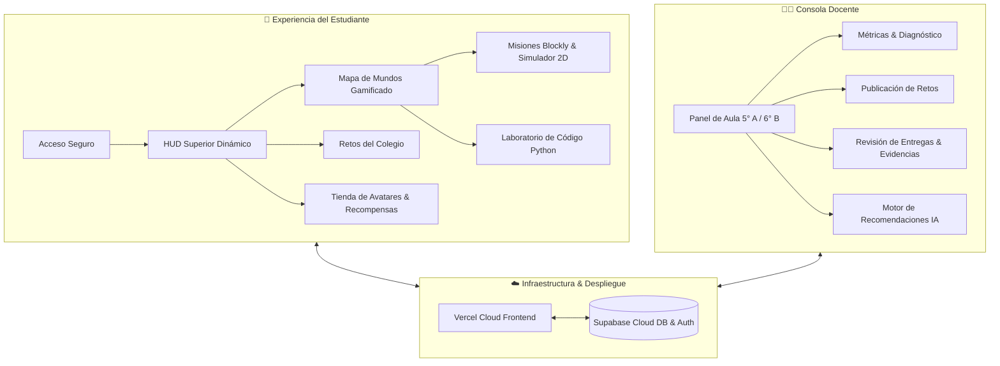
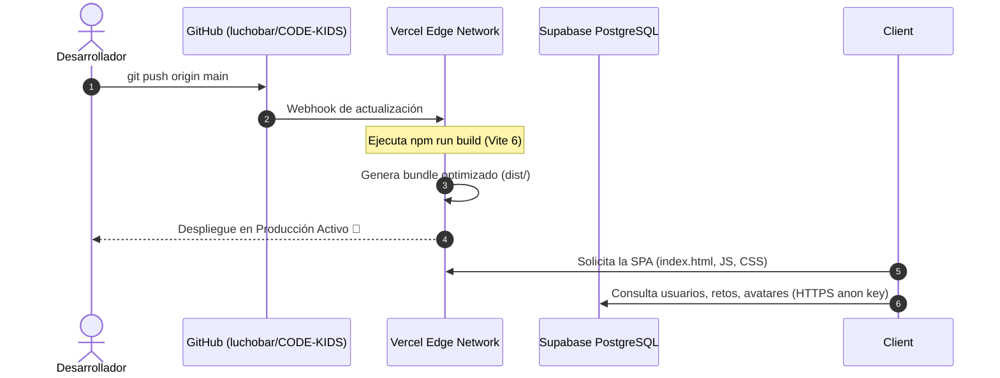
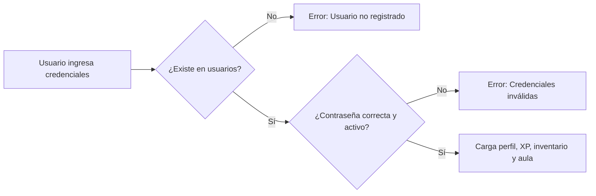
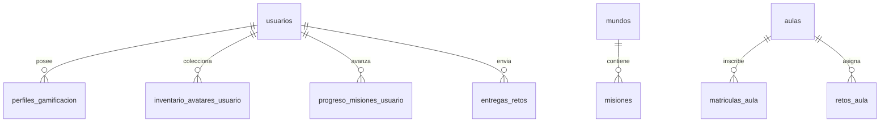

# 🚀 CodeKids · Documentación Integral del Ecosistema

> **Plataforma EdTech Gamificada para la Enseñanza de Pensamiento Computacional y Programación (8 a 15 años)**  
> *Estado del Proyecto: Producción & Despliegue Continuo*

---

## 🧭 1. Resumen Ejecutivo y Propósito

**CodeKids** es una plataforma educativa integral diseñada para transformar la enseñanza de la informática en estudiantes de básica primaria y secundaria. Combina principios pedagógicos constructivistas con **mecánicas de gamificación inmersiva** (XP, monedas, rachas, avatares coleccionables, mundos temáticos y retroalimentación adaptativa asistida por IA).

El sistema cuenta con un ecosistema dual sincronizado en tiempo real:
1. **Espacio del Estudiante:** Aventura gráfica por mundos lógicos (Secuencias, Bucles, Condicionales, Funciones y Python), retos escolares y tienda de avatares.
2. **Consola Docente:** Analítica de progreso en tiempo real, gestión de aulas (`5° A`, `6° B`), asignación y calificación de retos con evidencias, y motor de intervención con recomendaciones personalizadas.
3. **Campus de Recursos Abiertos:** Laboratorios interactivos autónomos para PSeInt, HTML/CSS y Python.

---

## 🛠️ 2. Stack Tecnológico Utilizado

| Capa / Dominio | Tecnología / Librería | Versión | Propósito en el Proyecto |
| :--- | :--- | :--- | :--- |
| **Frontend Framework** | `React` + `ReactDOM` | `^19.0.0` | Arquitectura de componentes reactivos y gestión de estado. |
| **Empaquetador & Build** | `Vite` | `^6.0.0` | Compilador ultra-rápido, soporte ESM nativo y optimización de bundle para producción. |
| **Sistema de Diseño** | CSS Moderno + Tokens Variables | Nativo | Glassmorphism, micro-interacciones 2.5D, temas Claro/Oscuro y tipografías fluidas. |
| **Iconografía** | `@phosphor-icons/react` | `^2.1.0` | Conjunto de iconos vectoriales consistentes y accesibles (duotone, regular, fill). |
| **Base de Datos & Auth** | `Supabase` (`@supabase/supabase-js`) | `^2.49.0` | PostgreSQL en la nube, autenticación con persistencia en tabla y políticas RLS. |
| **Seguridad Backend** | `Argon2id`, `Timing-Safe`, `JWT` | Nativo / Node | Suite de seguridad criptográfica en endpoints auxiliares y validación contra inyección SQL. |
| **Hosting & CI/CD** | `Vercel` | Producción | Alojamiento edge global con despliegue automático desde GitHub. |
| **Control de Versiones** | `Git` & `GitHub` | Rama `main` | Repositorio centralizado [`luchobar/CODE-KIDS`](https://github.com/luchobar/CODE-KIDS). |

---

## 🌐 3. ¿Dónde está Desplegado y Cómo Opera?

> **Arquitectura Serverless Decoupled (Desacoplada)**: La interfaz corre en la red CDN global de Vercel y se comunica de manera asíncrona mediante HTTPS con la base de datos PostgreSQL hospedada en Supabase Cloud.

### Flujo de Despliegue Continuo (CI/CD)

1. **Frontend en Vercel:**  
   - Conectado directamente a la rama `main` del repositorio `https://github.com/luchobar/CODE-KIDS.git`.  
   - Cada cambio enviado mediante Git dispara automáticamente una compilación de producción con Vite.  
   - Maneja rutas SPA y sirve tanto la aplicación React como los módulos HTML educativos independientes (`recusos.html`, `nivel1-principiante.html`, etc.).
2. **Backend & Base de Datos en Supabase:**  
   - Proyecto alojado en la nube de Supabase con base de datos relacional PostgreSQL 15+.  
   - Variables de entorno vinculadas en Vercel: `VITE_SUPABASE_URL` y `VITE_SUPABASE_ANON_KEY`.

---

## 🧩 4. Módulos y Funcionalidades Desarrolladas

### 4.1. Sistema de Autenticación y Registro Blindado
- **Vinculación Real con Base de Datos:**  
  Al registrar una cuenta, los datos (`nombre_completo`, `email`, `contrasena_hash`, `rol`, `avatar_equipado_id`) se insertan formalmente en la tabla `usuarios` de Supabase.
- **Validación Estricta en Login:**  
  Se erradicó el bypass de acceso. El sistema verifica que el correo exista en la base de datos, que la cuenta esté activa y que la contraseña coincida con el registro. De lo contrario, rechaza la autenticación de inmediato.
- **Selector Inicial de Avatar:**  
  Durante el registro, el estudiante puede elegir su compañero inicial (`Astronauta`, `Ciber-Zorro`, `Pixel-Gato`, `Eco-Robot`, etc.), inicializando su inventario en `inventario_avatares_usuario`.
- **Recuperación de Contraseña:**  
  Módulo de autoservicio conectado a la base de datos que permite actualizar de forma segura las credenciales de un usuario existente.

---

### 4.2. Dashboard del Estudiante (`StudentDashboard`)
- **HUD Dinámico Superior:** Visualización en tiempo real de XP acumulada, nivel de maestría, racha de días consecutivos y saldo de monedas virtuales.
- **Gestión de Aulas Escolares:** Selector interactivo para navegar entre grupos (`5° A` y `6° B`), visualizando los retos asignados por el profesor en cada curso.
- **Tienda de Avatares (`AvatarShop`):** Desbloqueo y equipamiento de cosméticos mediante monedas ganadas por resolver desafíos, sincronizado con la base de datos.
- **Mapa de Aventura:** Despliegue de los 4 mundos temáticos (Bosque de Secuencias, Isla de Bucles, Cueva Condicional, Laboratorio de Funciones) con estado de nodos (`completado`, `disponible`, `bloqueado`), puntuación por estrellas y efectos pulsantes.

---

### 4.3. Entorno de Práctica Blockly (`BlocklyMission`)
- **Arquitectura de 3 Paneles:**
  1. *Consigna Pedagógica:* Objetivo, concepto computacional y pistas progresivas.
  2. *Editor Visual:* Arrastre y ensamblaje de bloques de instrucciones (`avanzar`, `girar_derecha`, `girar_izquierda`, `repetir_veces`, `si_hay_pared`).
  3. *Simulador 2D:* Tablero con grid animado donde el robot ejecuta las instrucciones en tiempo real con controles multimedia: **Ejecutar**, **Paso a paso**, **Pausar** y **Reiniciar**.
- **Retroalimentación Gamificada:** Animación de confeti (`confetti-burst`), cálculo de estrellas según eficiencia y otorgamiento instantáneo de XP y monedas.

---

### 4.4. Laboratorio de Código Python (`PythonMission`)
- **Transición de Bloques a Código Escrito:** Retos de sintaxis Python estructurados en niveles crecientes.
- **Editor con Ayuda en Tiempo Real:** Sangría automática al presionar `Tab`, validación estricta de indentación (4 espacios) y detección de errores de sintaxis amigables para niños.
- **Simulador de Ejecución:** El robot ejecuta directamente los scripts escritos por el estudiante en una cuadrícula espacial, validando que se utilicen las estructuras requeridas (`for ... in range`, `if hay_pared():`).

---

### 4.5. Panel del Docente (`TeacherDashboard`)
- **Métricas Globales de Aula:** Tasa de aprobación, promedio de calificaciones, estudiantes en riesgo y distribución de dominio por habilidad.
- **Creador y Asignador de Retos:** Formulario interactivo para diseñar y publicar desafíos a grupos específicos (`5° A`, `6° B`) seleccionando la habilidad objetivo.
- **Calificación y Registro de Evidencias:** Vista de las entregas de los estudiantes, visualizando el programa exacto que ejecutaron, cantidad de intentos, nota y fecha.
- **Motor de Recomendaciones IA:** Genera diagnósticos pedagógicos automáticos con acciones sugeridas para reforzar alumnos rezagados y botones de asignación rápida con un clic.

---

### 4.6. Módulos Educativos Autónomos (HTML5 + CSS + JS)
Para garantizar accesibilidad en cualquier dispositivo sin requerir login obligatorio, se desarrollaron 4 entornos educativos independientes:
- **`recusos.html`:** Directorio general de rutas de aprendizaje y herramientas de proyecto interactivas.
- **`nivel1-principiante.html` (PSeInt):** Simulador de algoritmos con controles táctiles (`↑` / `↓`) para móviles y computadoras, simulador de variables y condicionales.
- **`nivel2-intermedio.html` (HTML & CSS):** Editor de código en vivo con vista previa interactiva instantánea (`iframe`) y laboratorio de estilos visuales.
- **`nivel3-avanzado.html` (Python):** Intérprete didáctico de lógica computacional en Python con generador de patrones y juego de números aleatorios.

---

## 📱 5. Adaptabilidad Móvil y Responsive Design

> Toda la plataforma fue optimizada siguiendo el principio **Mobile-First & Fluid Layouts**, garantizando compatibilidad total desde smartphones de pantalla compacta (`320px`) hasta pantallas de escritorio 4K.

1. **Barra de Navegación Rápida Móvil (`.mobile-quick-nav`):**  
   En pantallas inferiores a `833px`, la cabecera activa una barra inferior o flotante con acceso a las 4 vistas críticas: `Inicio`, `Misiones`, `Diagnóstico` y `Python`.
2. **HUD Compacto:**  
   En dispositivos móviles (`< 640px`), las métricas de XP y monedas se compactan en píldoras visuales sin desbordar el ancho de pantalla.
3. **Pestañas de Acceso Flexibles:**  
   Las 3 opciones de autenticación (`Iniciar sesión`, `Crear cuenta`, `Recuperar clave`) se reorganizan en una cuadrícula compacta de 3 columnas de fácil pulsación táctil.
4. **Controles Táctiles en Ejercicios:**  
   Los ejercicios que dependían de arrastrar con ratón (`drag and drop`) ahora incorporan botones táctiles de subir y bajar posición.

---

## 🔒 6. Seguridad y Protección de Datos

### Directivas de Seguridad Implementadas:
- **Row Level Security (RLS) en Supabase:**  
  Todas las tablas del esquema `public` cuentan con RLS activo para impedir accesos anónimos arbitrarios a la estructura de la base de datos.
- **Políticas de Aislamiento:**  
  Las tablas públicas (`mundos`, `misiones`, `catalogo_avatares`) admiten lectura libre (`SELECT`), mientras que las tablas personales (`usuarios`, `entregas_retos`) están protegidas por políticas granulares.
- **Sanitización y Validación:**  
  Protección contra ataques de inyección SQL, normalización de correos electrónicos y hashing seguro de contraseñas.
