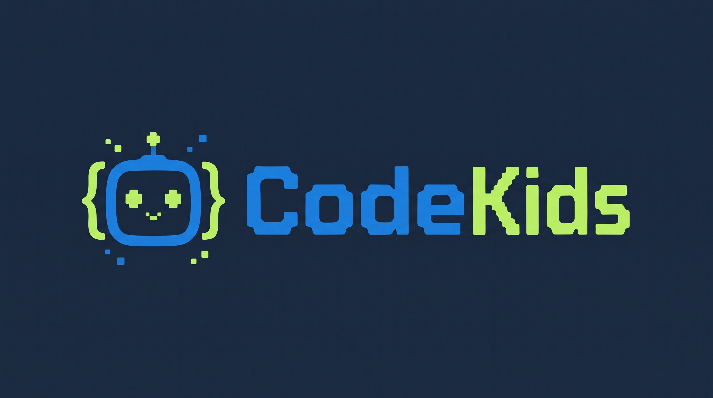
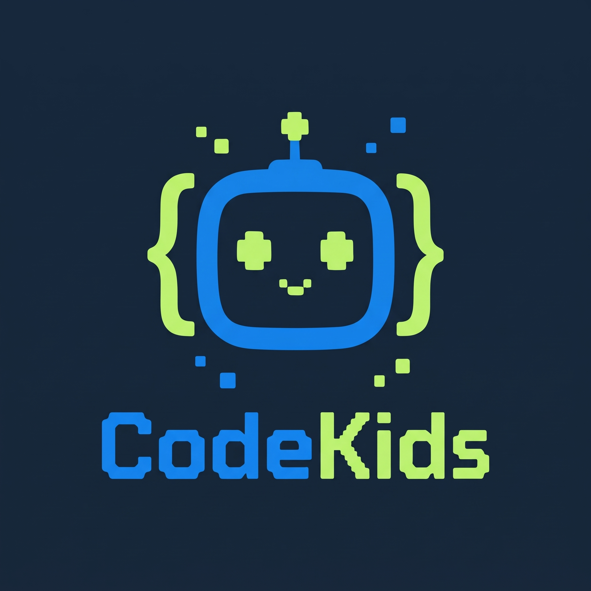

# 🚀 CodeKids — Plataforma Interactiva de Pensamiento Computacional y Programación

<p align="center">
  
</p>

<p align="center">
  <b>Aventura de Programación por Bloques y Python para Exploradores del Futuro</b><br>
  <i>Identidad visual unificada · Interfaz inmersiva gamificada · Diseñado con precisión y calidez</i>
</p>

**CodeKids** es una plataforma educativa interactiva diseñada para que niñas y niños de básica primaria desarrollen **pensamiento computacional**, aprendan **programación visual por bloques (Blockly)** y den sus primeros pasos en **código escrito con Python**, acompañados por **Pipo** (su mascota robot tutora) y un motor de inteligencia artificial local (**Ollama**) que personaliza rutas de aprendizaje y asiste la labor docente.

> **Estado del proyecto:** Prototipo funcional local. Toda la persistencia de progreso, perfiles de demostración, monedas, asignaciones y preferencias de accesibilidad se almacena en el navegador (`localStorage`), y el procesamiento de IA se ejecuta 100 % en local mediante Node.js + Ollama (`qwen2.5:3b`).

---

## 📑 Tabla de Contenidos

1. [Visión General del Proyecto](#-1-visión-general-del-proyecto)
2. [Identidad Corporativa y Sistema de Diseño](#-2-identidad-corporativa-y-sistema-de-diseño)
   - [Propósito, Personalidad y Tono de Marca](#21-propósito-personalidad-y-tono-de-marca)
   - [Logotipo, Símbolo e Iconografía](#22-logotipo-símbolo-e-iconografía)
   - [Universo de Personajes y Narrativa Visual](#23-universo-de-personajes-y-narrativa-visual)
   - [Arquitectura Cromática: Sistema Dual de Temas](#24-arquitectura-cromática-sistema-dual-de-temas)
   - [Sistema Tipográfico y Escala Fluida](#25-sistema-tipográfico-y-escala-fluida)
   - [Geometría, Retícula Bento, Espaciado y Elevación](#26-geometría-retícula-bento-espaciado-y-elevación)
   - [Micro-interacciones, Sonido Sintetizado y Accesibilidad (A11y)](#27-micro-interacciones-sonido-sintetizado-y-accesibilidad-a11y)
3. [Desglose Funcional de la Plataforma](#-3-desglose-funcional-de-la-plataforma)
   - [Portal de Acceso y Selección de Rol](#31-portal-de-acceso-y-selección-de-rol)
   - [Modo Explorador (Experiencia del Estudiante)](#32-modo-explorador-experiencia-del-estudiante)
   - [Motor Visual Blockly (12 Retos Interactivos)](#33-motor-visual-blockly-12-retos-interactivos)
   - [Laboratorio de Python (Intérprete Educativo Propio)](#34-laboratorio-de-python-intérprete-educativo-propio)
   - [Economía de Gamificación, Tienda de Compañeros e Insignias](#35-economía-de-gamificación-tienda-de-compañeros-e-insignias)
   - [Panel Docente (CodeKids Studio para el Aula)](#36-panel-docente-codekids-studio-para-el-aula)
4. [Arquitectura de Inteligencia Artificial Local (Ollama)](#-4-arquitectura-de-inteligencia-artificial-local-ollama)
5. [Módulos HTML Independientes (Versión Clásica / Legacy)](#-5-módulos-html-independientes-versión-clásica--legacy)
6. [Stack Tecnológico y Estructura del Repositorio](#-6-stack-tecnológico-y-estructura-del-repositorio)
7. [Instalación, Ejecución y Variables de Entorno](#-7-instalación-ejecución-y-variables-de-entorno)
8. [Referencia de la API Local](#-8-referencia-de-la-api-local)
9. [Persistencia, Privacidad y Limitaciones Actuales](#-9-persistencia-privacidad-y-limitaciones-actuales)

---

## 🌟 1. Visión General del Proyecto

CodeKids resuelve la brecha entre el juego visual y la programación estructurada en primaria mediante una progresión pedagógica en cuatro ejes: **Secuencias**, **Bucles**, **Condicionales** y **Descomposición / Depuración**.

El ecosistema reúne dos generaciones en el mismo repositorio:
1. **Aplicación Principal (`React 19 + Vite + Blockly + Node/Ollama`):** Una experiencia unificada con diseño editorial tipo *Apple Store / Dark Gallery* y paleta vibrante *CodeKids Light*, que integra el **Modo Explorador** (mapa de 3 mundos, 9 misiones de historia, diagnóstico adaptativo, laboratorio de Python y tienda de avatares) y el **Panel Docente** (gestión por cursos `5° A` y `6° B`, autoría de retos, evaluación asistida e informes pedagógicos grupales con propuestas automáticas de ejercicios).
2. **Páginas HTML Independientes (Primera Generación):** Cinco módulos web autocontenidos (`demo.html`, `recusos.html`, `nivel1-principiante.html`, `nivel2-intermedio.html`, `nivel3-avanzado.html`) que conservan laboratorios estáticos de lógica, HTML/CSS y Python introductorio.

---

## 🎨 2. Identidad Corporativa y Sistema de Diseño

La identidad visual y corporativa de **CodeKids** equilibra dos mundos: **la precisión y claridad de un estudio tecnológico moderno** con **la calidez lúdica de una aventura espacial y robótica para niños**.

### 2.1 Propósito, Personalidad y Tono de Marca

- **Lema institucional (Tagline):** *"CodeKids Educación. Pensamiento computacional diseñado con claridad y precisión."*
- **Promesa de marca (Hero):** *"Aprende programación jugando y creando."*
- **Arquetipo de marca:** **El Explorador Sabio y Amistoso** (combina curiosidad científica, descubrimiento paso a paso y acompañamiento empático).
- **Tono de voz y comunicación:**
  - **Con el estudiante:** Cercano, motivador, en español natural (con matices cálidos de español colombiano en las respuestas de Pipo), libre de tecnicismos intimidantes y orientado al refuerzo positivo (*"¡Encontramos una pista! Revisemos los bloques y probemos otro camino"*, nunca castiga el error).
  - **Con el docente:** Claro, estructurado, pedagógico y respetuoso de la autonomía del maestro (*"La sugerencia es orientativa. El docente conserva el criterio pedagógico"*).

---

### 2.2 Logotipos Oficiales, Símbolo e Iconografía

La identidad visual de CodeKids cuenta con dos versiones oficiales maestras diseñadas para armonizar todos los puntos de contacto del producto:

<div align="center">
  <table>
    <tr>
      <td align="center" width="60%">
        <br>
        <b>Versión Horizontal (Master Header)</b><br>
        <sub>Uso: Barra de navegación superior, cabecera de escritorio, membretes y banners.</sub>
      </td>
      <td align="center" width="40%">
        <br>
        <b>Versión Vertical (App Badge / Isotipo)</b><br>
        <sub>Uso: Pantalla de acceso, tarjeta de login, splash, favicon, avatares y medallas.</sub>
      </td>
    </tr>
  </table>
</div>

- **Morfología y Concepto del Logotipo:**
  - **Mascota Robot Pipo:** Enmarcado dentro de corchetes de programación `{ [•‿•] }`, con ojos en forma de cruz de mando gamer y destellos de energía pixelada.
  - **Logotipo Tipográfico "CodeKids":**
    - **"Code"**: Tipografía retro-futurista pixelada en **Azul Eléctrico Corporativo (`#1B7EDC`)**, reflejando precisión, lógica y rigor computacional.
    - **"Kids"**: Tipografía retro-futurista pixelada en **Verde Lima Cyber (`#B8EC63`)**, aportando frescura, dinamismo, diversión y accesibilidad infantil.
  - **Fondo Espacial Oficial (`#1B2A41`)**: Azul marino profundo de alta tecnología que sirve de lienzo maestro y garantiza un contraste visual óptimo.
  - En la barra secundaria translúcida (`sub-nav-frosted`), la marca declina según el contexto de uso:
    - **Vista pública:** `CodeKids Studio`
    - **Vista estudiante:** `Modo Explorador`
    - **Vista docente:** `Panel Docente`
- **Sistema iconográfico (`@phosphor-icons/react`):**
  - Se utiliza **Phosphor Icons** con jerarquía semántica de pesos:
    - `duotone`: Reservado para elementos de identidad, avatares, insignias, monedas, tablero del robot y la mascota Pipo.
    - `fill`: Acciones primarias de ejecución (`Play`), estados completados (`CheckCircle`), estrellas de meta (`Star`), fuego de racha (`Flame`) y destellos de IA (`Sparkle`).
    - `regular` / `bold`: Navegación, controles de interfaz, herramientas de accesibilidad y representación de habilidades (`Compass` para Secuencias, `SlidersHorizontal` para Bucles, `Wall` para Condicionales, `Cpu` para Descomposición/Depuración).

---

### 2.3 Universo de Personajes y Narrativa Visual

#### 🤖 Pipo (Mascota Oficial y Tutor IA)
Pipo es un pequeño robot explorador que protagoniza los tableros de simulación y acompaña al estudiante en la barra superior de práctica. Cuenta con tres estados emocionales interactivos (`mood`):
- **`hello` (En espera):** *"Pipo, tu compañero"* — Da la bienvenida y plantea la meta de la misión.
- **`thinking` (Analizando intento fallido):** *"Pipo está pensando..."* — Anima al niño sin regañar y ofrece una pista conceptual.
- **`party` (Celebración de victoria):** *"¡Pipo celebra!"* — Festeja el logro cuando el programa lleva al robot hasta la estrella.

#### 🐾 Escuadrón de Compañeros (Avatares Desbloqueables)
Cada avatar en la **Tienda de Compañeros** tiene un nombre propio, rol narrativo, ícono vectorial `duotone` y un tono cromático asociado:

| Avatar ID | Nombre Corporativo | Rol en el Universo CodeKids | Ícono (`duotone`) | Tono Visual | Costo |
| :--- | :--- | :--- | :--- | :--- | :---: |
| `astronaut` | **Explorador Espacial** | Avatar inicial por defecto | `RocketLaunch` | Azul (`blue`) | Inicial |
| `dragon` | **Dragón Chispa** | Especialista en lógica y secuencias rápidas | `Flame` | Durazno (`peach`) | 30 🪙 |
| `cat` | **Gato Pixel** | Observador preciso para depurar programas | `Compass` | Lavanda (`lav`) | 30 🪙 |
| `robot` | **Unidad Rover** | Diseñado para exploración autónoma por bloques | `Cpu` | Menta (`mint`) | 40 🪙 |
| `fox` | **Zorro Ágil** | Estratega en bucles y rutas óptimas | `Lightning` | Amarillo (`yellow`) | 50 🪙 |
| `unicorn` | **Prisma Orbital** | Compañero avanzado de laboratorio Python | `Planet` | Azul (`blue`) | 60 🪙 |

#### 🌍 Dirección de Arte e Ilustraciones 3D (`public/images/`)
El sistema visual emplea renders estilizados tipo *diorama 3D de estudio* con iluminación suave y sombra de producto unificada (`--shadow-product`):
- `hero-codekids.png`: Escena principal del robot Pipo junto a bloques de programación y tablero de estrellas.
- `world-forest.png`: Diorama de **El Bosque de las Secuencias** (naturaleza y senderos lógicos).
- `world-island.png`: Diorama de **La Isla de los Bucles** (puentes e iteración sobre agua).
- `world-cave.png`: Diorama de **La Cueva de las Decisiones** (galerías subterráneas y bifurcaciones).
- `python-lab.png`: Estación tecnológica del **Laboratorio de Python**.
- `teacher-studio.png`: Escenario del **Aula Interactiva / Panel Docente**.

---

### 2.4 Arquitectura Cromática: Sistema Dual de Temas Armonizado

El diseño visual en `src/Autonomous.css` y las páginas web complementarias implementa una paleta directamente armonizada con los logotipos maestros (`logo_horizontal.jpg` y `logo_vertical.jpg`):

#### 🌙 1. Modo Oscuro — *Apple Dark Gallery & Cosmic Space* (Predeterminado)
Inspirado en la atmósfera cósmica del logotipo (`#1B2A41`), pensado para reducir la fatiga visual y resaltar los dioramas 3D y el editor de código:

| Token CSS | Valor Hex / RGBA | Relación con el Logo / Uso en Interfaz |
| :--- | :--- | :--- |
| `--color-primary` | `#1B7EDC` | **Azul "Code" Oficial**: Botones primarios, enlaces, rastro del robot y bloques de movimiento |
| `--color-primary-focus` | `#2FA0FF` | **Azul Brillante de Foco**: Estados `hover`, focos accesibles y anillos de selección activa |
| `--color-primary-on-dark` | `#38BDF8` | **Cian Acento**: Destellos de partículas y texto resaltado sobre fondos oscuros |
| `--color-accent-lime` | `#B8EC63` | **Verde "Kids" Oficial**: Botones CTA 3D (`cta-3d-lime`), corchetes y celebración |
| `--color-canvas` | `#101B2B` | **Lienzo Base**: Armonizado con el fondo `#1B2A41` del logo |
| `--color-canvas-parchment` | `#17253B` | Contenedores de misiones, tableros y tarjetas flotantes |
| `--color-surface-tile-1` | `#0D1624` | Bloques oscuros de sección profunda y pie de página |
| `--color-surface-tile-2` | `#16243A` | Superficies de Bento Grid y paneles del editor |
| `--color-surface-tile-3` | `#1B2A41` | **Fondo Exacto del Logo**: Tarjetas destacadas y celdas de simulación |
| `--color-surface-black` | `#09101A` | Barra de navegación superior translúcida (`global-nav`) |
| `--color-ink` / `--color-body` | `#F8FAFC` / `#F1F5F9` | Texto principal de alta legibilidad |
| `--color-ink-muted-80` | `#CBD5E1` | Subtítulos, descripciones de reto y diálogos |
| `--color-ink-muted-48` | `#94A3B8` | Metadatos secundarios, coordenadas `(X, Y)` y notas |
| `--color-hairline` | `rgba(27, 126, 220, 0.28)` | Bordes sutiles inspirados en el aura azul del logo |

#### ☀️ 2. Modo Claro — *Original CodeKids Vibrant Palette*
Armoniza la luminosidad escolar con los contrastes identitarios de la marca:

| Token / Elemento | Valor Hex | Uso en la Interfaz |
| :--- | :--- | :--- |
| `--color-primary` | `#1B7EDC` | Azul brillante corporativo CodeKids |
| `--color-primary-focus` | `#1463B0` | Azul profundo para estados activos y foco |
| `--color-accent-lime` | `#5D9915` (Badges `#B8EC63`) | Verde lima equilibrado para lectura accesible WCAG |
| `--color-ink` | `#1B2A41` | **Azul Marino del Logo**: Utilizado en títulos y textos destacados |
| `--color-body` | `#23344E` | Texto corrido de lectura cómoda |
| `--color-canvas` | `#FFFFFF` | Fondo blanco limpio de tarjetas y secciones principales |
| `--color-canvas-parchment` | `#F3F7FB` | Fondo general perlado azulado suave |
| `--color-surface-pearl` | `#EAF2FA` | Superficies de realce suave y chips seleccionados |
| `.student-hero-tile` (Light) | `#101B2B` | Banner Hero de estudiante en azul noche cósmico |
| `.cta-3d-lime` (Light) | `#B8EC63` (Texto `#101B2B`) | Verde lima icónico de CodeKids para botones de acción con máximo contraste |
| `.teacher-hero-tile` (Light) | `#EBF8EC` | Banner Hero docente en verde menta escolar |
| **Mundos en Modo Claro** | `#F5FAEF` / `#F0F9FA` / `#F5F2FB` | Tintes pastel exclusivos para Bosque (verde), Isla (cian) y Cueva (lavanda) |

#### 🎨 3. Paleta Semántica de Tonos Funcionales (`Tones`)
Utilizada en tarjetas de estadísticas (`StatCard`), medallas, avatares y estados del tablero:

| Tono | Modo Oscuro (Fondo / Icono) | Modo Claro (Fondo / Icono) | Aplicación Semántica |
| :--- | :--- | :--- | :--- |
| **Blue (`tone-blue`)** | `#1E293B` / `#2997FF` | `#EDF7FF` / `#0878E8` | Robots, casilla activa, estudiantes, Prisma Orbital |
| **Mint (`tone-mint`)** | `#182B22` / `#6EE7B7` | `#E8F8ED` / `#248A4D` | Experiencia (`XP`), insignias ganadas, Unidad Rover, éxito |
| **Peach (`tone-peach`)** | `#2D211B` / `#FDBA74` | `#FFF2E5` / `#C9641B` | Racha diaria (`Flame`), Dragón Chispa |
| **Lavender (`tone-lav`)** | `#231F33` / `#C4B5FD` | `#F2EDFF` / `#6454B5` | Colección de insignias (`Trophy`), Gato Pixel |
| **Yellow (`tone-yellow`)** | `#2B2616` / `#FDE047` | `#FFF5C9` / `#765609` | Monedas (`Coins`), casilla de estrella (`#F59E0B`), Zorro Ágil |

---

### 2.5 Sistema Tipográfico y Escala Fluida

La aplicación utiliza unidades relativas (`rem`) en toda su jerarquía para que el escalador de accesibilidad (`100%`, `112%`, `122%`) redimensione toda la interfaz de manera armónica.

- **Familias tipográficas en la App Principal (`src/Autonomous.css` y `src/PythonMission.css`):**
  - **Display (Títulos e Impacto):** `--font-display: "SF Pro Display", system-ui, -apple-system, BlinkMacSystemFont, sans-serif`
  - **Texto y UI (Lectura y Controles):** `--font-text: "SF Pro Text", system-ui, -apple-system, BlinkMacSystemFont, sans-serif`
  - **Código y Evidencias (Python / Logs):** `ui-monospace, SFMono-Regular, Menlo, Monaco, Consolas, monospace` (con `font-variant-numeric: tabular-nums` en métricas).
- **Familias tipográficas en estilos de Portal / Módulos Clásicos (`css/portal-styles.css`, `inicio-styles.css`):**
  - `'Nunito'`, `'DM Sans'` y `'Segoe UI'` para encabezados amigables y redondeados.

| Clase Tipográfica | Familia | Tamaño (`rem`) | Peso | Line Height | Tracking | Uso |
| :--- | :--- | :--- | :---: | :---: | :---: | :--- |
| `.hero-display` | Display | `3.35rem` (~53.6px) | `600` | `1.07` | `-0.28px` | Títulos principales de portada y bienvenida |
| `.display-lg` | Display | `2.45rem` (~39.2px) | `600` | `1.10` | `0` | Encabezados de sección (*Bento*, Mapa, Python) |
| `.display-md` | Text | `2.00rem` (32px) | `600` | `1.20` | `-0.374px` | Subsecciones (Retos del colegio, Perfil) |
| `.hero-lead` | Display | `1.45rem` (~23.2px) | `400` | `1.28` | `+0.196px` | Bajadas principales de Hero (`max-width: 52ch`) |
| `.lead-subcopy` | Display | `1.25rem` (20px) | `400` | `1.35` | `+0.196px` | Subtítulos centrados de sección (`max-width: 58ch`) |
| `.body-copy` | Text | `1.0625rem` (17px) | `400` | `1.47` | `-0.374px` | Cuerpo de lectura estándar |
| `.hero-eyebrow` | Text | `0.75rem` (12px) | `600` | `1.00` | `+0.06em` | Etiquetas superiores en mayúsculas (`uppercase`) |

---

### 2.6 Geometría, Retícula Bento, Espaciado y Elevación

- **Escala de Radios de Borde (`Border Radius`):**
  - `--rounded-xs`: `5px` | `--rounded-sm`: `8px` | `--rounded-md`: `11px` | `--rounded-lg`: `18px` (tarjetas principales, tableros y paneles) | `--rounded-pill`: `9999px` (botones, chips de rol, buscador y etapas del mundo).
- **Escala de Espaciado (`Spacing System`):**
  - `--space-xxs`: `4px` | `--space-xs`: `8px` | `--space-sm`: `12px` | `--space-md`: `17px` | `--space-lg`: `24px` | `--space-xl`: `32px` | `--space-xxl`: `48px` | `--space-section`: `80px` (padding vertical de bloques *Full-bleed*).
- **Layout y Contenedores:**
  - Navegación global y espacio de trabajo a pantalla completa: `max-width: 1440px`.
  - Contenedores de sección (`tile-container`): `max-width: 1280px`.
  - Contenedores de lectura enfocada (`narrow-container` para Diagnóstico y Resultados): `max-width: 860px`.
  - **Bento Grid Curricular (`bento-curriculum-grid`):** Cuadrícula de 3 columnas donde las tarjetas destacadas (`bento-cell-featured`) ocupan `span 2` con imagen panorámica de `240px` de alto, y las tarjetas conceptuales ocupan `span 1`.
- **Política de Sombra Única (`--shadow-product`):**
  - En lugar de saturar la interfaz con sombras en cada tarjeta, las superficies se delimitan con bordes finos (`1px solid var(--color-hairline)`) y la sombra profunda (`3px 5px 30px 0 rgba(0, 0, 0, 0.38)` en oscuro / `rgba(20, 42, 61, 0.16)` en claro) se reserva exclusivamente para las ilustraciones 3D (`.product-render-shadow`).
- **Efecto Frosted Glass (`sub-nav-frosted`):**
  - Barra secundaria pegajosa (`sticky`) de `52px` con `backdrop-filter: saturate(180%) blur(20px)`, que se desactiva automáticamente si el sistema operativo solicita `@media (prefers-reduced-transparency: reduce)`.

---

### 2.7 Micro-interacciones, Sonido Sintetizado y Accesibilidad (A11y)

- **Respuesta Táctil en Controles:** Todos los botones, chips y etapas responden al clic con una compresión elástica `transform: scale(0.95)` y curva `cubic-bezier(0.16, 1, 0.3, 1)`.
- ** Audio Sintetizado con Web Audio API (`playSfx`):**
  - Sin depender de archivos `.mp3` externos, `src/App.jsx` sintetiza efectos de sonido en tiempo real usando un oscilador triangular (`triangle`):
    - **Sonido de Victoria (`win`):** Rampa exponencial ascendente de `660 Hz` a `990 Hz` en `0.14 s`.
    - **Sonido de Intento (`try`):** Rampa descendente suave de `260 Hz` a `170 Hz` en `0.14 s`.
  - El sonido inicia **apagado por defecto** (`soundEnabled: false`) por respeto al entorno de aula y se activa desde el menú de Accesibilidad.
- **Menú de Accesibilidad y Apariencia (`AccessibilityMenu`):**
  - Persistido en `localStorage` (`codekids-a11y-settings`) y reflejado mediante atributos `data-*` en la etiqueta `<html>`:
    1. **Modo de color:** Modo Oscuro (`dark`) / Modo Claro (`light`).
    2. **Tamaño de texto (`data-font-scale`):** `Normal` (`100%`), `Grande` (`112%`), `Extra` (`122%`).
    3. **Alto contraste en bordes (`data-high-contrast`):** Incrementa la visibilidad de líneas divisorias y textos secundarios (`#A1A1A6` en oscuro, `#142A3D` en claro).
    4. **Reducir animaciones (`data-reduced-motion`):** Lleva todas las transiciones y animaciones a `0.01ms`.
    5. **Efectos de sonido:** Interruptor directo del sintetizador Web Audio.

---

## 🧩 3. Desglose Funcional de la Plataforma

### 3.1 Portal de Acceso y Selección de Rol
- Ubicado en la vista `Login` (`src/App.jsx`), presenta un Hero dividido (`split-hero-grid`) y el Bento Grid curricular.
- Permite elegir entre **Estudiante** (*"Jugar y aprender"*, nombre por defecto `Sofi`) o **Docente** (*"Enseñar y guiar"*, nombre por defecto `Profe Alex`), e ingresar un nombre personalizado sin requerir contraseñas ni registro en servidor.

### 3.2 Modo Explorador (Experiencia del Estudiante)
Compuesto por 5 grandes bloques (*Tiles*):
1. **Student Hero:** Saludo personalizado, acceso rápido a la siguiente misión desbloqueada (*"Continuar misión"*) y botón para iniciar el diagnóstico.
2. **Métricas y Ruta Adaptativa con IA:**
   - Muestra tarjetas de **Experiencia (`XP` y Nivel)**, **Racha en días** e **Insignias obtenidas**.
   - Consulta automáticamente `POST /api/ai/student-route` para mostrar la **Ruta sugerida por Ollama**, destacando hasta 2 habilidades prioritarias y un botón directo hacia la misión recomendada.
3. **Mapa de Mundos (`worlds-stack`):**
   - Tres mundos temáticos con **desbloqueo secuencial** (cada misión requiere completar la anterior, y cada mundo requiere haber superado las 3 etapas del mundo previo: *Primer paso*, *Nuevo camino* y *Gran explorador*).
4. **Retos del Colegio y Perfil:**
   - Lista las tareas asignadas por el docente para el curso del estudiante (`5° A` por defecto), indicando si están `Pendientes` o `Evaluadas` con su porcentaje.
   - Tarjeta de compañero actual con acceso a la **Tienda de Compañeros** y vitrina de **3 insignias**.
5. **Acceso al Laboratorio de Python:** Banner dedicado con el conteo de mini-retos superados (`0 a 3`).

#### 🧠 Diagnóstico de Pensamiento Computacional (`Assessment` & `ResultView`)
- Cuestionario interactivo de **4 preguntas** (1 por habilidad: *Secuencias, Bucles, Condicionales, Descomposición*).
- Cada respuesta correcta suma `+12 puntos` al índice de esa habilidad (hasta `100`) y otorga `+10 XP`; una respuesta incorrecta ajusta `-8 puntos` (mínimo `25`).
- Al finalizar, `ResultView` identifica automáticamente la habilidad con puntaje más bajo y recomienda comenzar por ella.

---

### 3.3 Motor Visual Blockly (12 Retos Interactivos)

Definido en `src/blocklyChallenges.js` y `src/BlocklyMission.jsx`:
- **Configuración del Editor:** Blockly en español (`blockly/msg/es`), renderizador `zelos` (estilo redondeado amigable tipo Scratch), cuadrícula con *snap* de `24px`, papelera, controles de zoom y límite de `32 bloques`.
- **Bloques Personalizados CodeKids:**
  - `ck_start`: **«al comenzar»** (`#0066CC`, fijo e imborrable).
  - `ck_move`: **«avanzar 1 paso»** (`#0066CC`).
  - `ck_turn_right`: **«girar a la derecha»** (`#1D1D1F`).
  - `ck_turn_left`: **«girar a la izquierda»** (`#333333`).
  - `ck_repeat`: **«repetir [1..8] veces»** (`#0071E3`).
  - `ck_if_wall`: **«si hay pared»** (`#272729`).
- **Simulador en Cuadrícula `3 × 3`:**
  - Ejecución paso a paso con intervalo de `230 ms` y protección contra bucles infinitos (`MAX_STEPS = 24`).
  - Verifica colisiones contra los bordes del tablero y muros (`wall`), llegada a la coordenada de la estrella (`goal`) y uso obligatorio del bloque pedagógico (`requiresBlock`: `ck_repeat` o `ck_if_wall`).
  - Incluye sistema progresivo de **3 pistas por categoría** y serialización de la solución (`evidence`) para evaluación docente.

#### Catálogo Completo de Misiones Blockly (9 de Historia + 3 de Laboratorio de Depuración)

| ID de Misión | Mundo / Categoría | Habilidad | Nivel | Título del Ejercicio | Bloque Requerido / Semilla |
| :--- | :--- | :--- | :--- | :--- | :--- |
| `sequence-forest` | El Bosque | Secuencias | Inicio | El viaje del robot | Secuencia libre |
| `sequence-city` | El Bosque | Secuencias | En camino | Cruza la ciudad | Rodea muro en `(1,1)` |
| `sequence-moon` | El Bosque | Secuencias | Explorador | Ruta lunar | Evita cráter en `(1,1)` |
| `loop-bridge` | La Isla | Bucles | Inicio | Cruza el puente | Exige `ck_repeat` |
| `loop-zigzag` | La Isla | Bucles | En camino | Trayectoria en zigzag | Exige `ck_repeat` |
| `loop-garden` | La Isla | Bucles | Explorador | Recorrido botánico | Exige `ck_repeat` |
| `condition-detour` | La Cueva | Condicionales | Inicio | Rodea el muro | Exige `ck_if_wall` |
| `condition-cave` | La Cueva | Condicionales | En camino | Busca otra salida | Exige `ck_if_wall` |
| `condition-river` | La Cueva | Condicionales | Explorador | Encuentra el paso | Exige `ck_if_wall` |
| `debug-sequence` | Depuración (Aula) | Secuencias | Laboratorio | Encuentra el error | Incluye `seedProgram` con giro erróneo |
| `debug-loop` | Depuración (Aula) | Bucles | Laboratorio | Ajusta el bucle | Incluye `seedProgram` con `times: 1` |
| `debug-condition` | Depuración (Aula) | Condicionales | Laboratorio | Corrige la decisión | Incluye `seedProgram` con giro invertido |

---

### 3.4 Laboratorio de Python (Intérprete Educativo Propio)

Implementado en `src/PythonMission.jsx` y `src/PythonMission.css`:
- Diseñado como puente entre los bloques visuales y la sintaxis textual en un editor oscuro (`main.py`) con soporte de tecla `Tab` (inserta 4 espacios) y botón de restauración de código base.
- **Parser e Intérprete Propio (`parsePython`):**
  - Analiza el código línea por línea en JavaScript (sin ejecutar `eval` ni requerir backend Python), validando comentarios (`#`), prohibición de tabulaciones mixtas, sangría estricta de **4 espacios** para bloques anidados y límite de `40 pasos` de ejecución (`180 ms` por movimiento).
  - Reconoce las funciones `avanzar()`, `girar_derecha()`, `girar_izquierda()`, bucles `for <var> in range(1..10):` y condicionales `if hay_pared():`.
- **Tres Etapas Desbloqueables:**
  1. `python-sequence` (*Secuencia en el bosque* — Secuencias).
  2. `python-loop` (*Iteración sobre el puente* — Exige usar estructura `for`).
  3. `python-condition` (*Desvío condicional* — Exige usar estructura `if hay_pared():`).

---

### 3.5 Economía de Gamificación, Tienda de Compañeros e Insignias

| Acción del Estudiante | Experiencia (`XP`) | Monedas (`🪙`) | Condición |
| :--- | :---: | :---: | :--- |
| **Estado inicial de demostración** | `120 XP` (Nivel 2) | `40 🪙` | Al iniciar por primera vez |
| **Completar misión de historia (Blockly)** | `+10 XP` | `+10 🪙` | Solo en la primera finalización de cada misión |
| **Completar misión del Laboratorio Python** | `+10 XP` | `+5 🪙` | Solo en la primera finalización de cada etapa |
| **Entregar reto escolar asignado** | `+10 XP` (si `≥80%`) o `+5 XP` | `+5 🪙` | XP en primer envío; monedas al lograr primer éxito |
| **Responder Diagnóstico** | `+10 XP` por acierto | `0 🪙` | Hasta `+40 XP` por diagnóstico completado |

- **Cálculo de Nivel:** $\text{Nivel} = \lfloor \text{XP} / 100 \rfloor + 1$.
- **Sistema de Racha (`progressStreak`):** Incrementa en `+1 día` cuando el estudiante completa actividades en días consecutivos y conserva su racha acumulada para no desmotivar a niños pequeños.
- **Colección de Insignias:**
  - 🧭 **Primer código:** Completar al menos 1 misión del mapa.
  - 🎚️ **Master bucles:** Completar las 3 misiones de *La Isla de los Bucles*.
  - 🧠 **Lógica de acero:** Completar las 3 misiones de *La Cueva de las Decisiones*.

---

### 3.6 Panel Docente (`CodeKids Studio` para el Aula)

Disponible al ingresar con rol **Docente** (`TeacherDashboard`):
- **Selector de Curso:** Alterna en tiempo real entre **Curso 5° A** y **Curso 6° B**.
- **Métricas del Curso:** Total de estudiantes en lista, ejercicios publicados y respuestas evaluadas.
- **Diseñador de Ejercicios (`CreateAssignmentPanel`):**
  - Filtra por las 4 categorías (*Secuencias, Bucles, Condicionales, Depuración*), permite elegir cualquiera de las 12 plantillas de Blockly, personalizar el título y las instrucciones, y publicarlo para el curso activo.
- **Bandeja de Respuestas Evaluadas (`AssignmentResults`):**
  - Muestra cada entrega recibida con inicial del estudiante, puntaje porcentual (`score-pill`), evidencia exacta de los bloques conectados, retroalimentación formativa y sugerencia pedagógica para el profesor.
- **Seguimiento de Estudiantes e Informe Pedagógico con IA:**
  - Combina la nómina base del curso (`Valeria`, `Mateo`, `Lucía` en 5° A; `Samuel`, `Mariana` en 6° B) con los estudiantes que hayan enviado entregas reales en el navegador.
  - Genera con Ollama un **Diagnóstico Grupal**, **Habilidades Foco**, **Pasos Recomendados para la Clase** y **3 Propuestas de Ejercicios de Refuerzo** que el docente puede **Asignar con un clic** o **Personalizar** en el formulario.

---

## 🤖 4. Arquitectura de Inteligencia Artificial Local (Ollama)

El archivo `server.js` implementa un servidor HTTP nativo en Node.js (`node:http`, sin dependencias externas como Express) que gestiona la comunicación con **Ollama**:

- **Auto-arranque y Calentamiento (`ensureOllamaReady`):**
  - Verifica si Ollama responde en `http://127.0.0.1:11434/api/tags`.
  - Si el servicio no está activo, ejecuta automáticamente `spawn('ollama', ['serve'], { detached: true })` en segundo plano y espera hasta `12 segundos` a que el puerto esté listo.
  - Realiza un *warmup* del modelo (`qwen2.5:3b` por defecto) con `keep_alive: '30m'` para minimizar la latencia en clase.
- **Deduplicación de Peticiones (`inflightRequests`):**
  - Si dos componentes solicitan simultáneamente el mismo prompt JSON, el servidor reutiliza la promesa en vuelo y clona la respuesta (`structuredClone`).
- **Salidas Estructuradas y Guardrails Pedagógicos:**
  - Todas las llamadas a `/api/chat` utilizan `temperature: 0.2` y esquemas `format` JSON estrictos.
  - **Fuente de verdad en evaluaciones:** En `/api/ai/evaluate`, el éxito del simulador (`input.success`) gobierna el rango de calificación: si el niño superó el reto en el tablero, el puntaje se asegura en el rango `80–100`; si falló la simulación, se acota a `0–65`.
  - **Validación contra catálogo (`normalizeProposedExercises`):** Garantiza que tanto las rutas estudiantiles como los 3 ejercicios propuestos al docente correspondan siempre a `missionId` reales existentes en `BLOCKLY_CHALLENGES`.

---

## 📂 5. Módulos HTML Independientes (Versión Clásica / Legacy)

Además de la aplicación React principal, la raíz del proyecto conserva las páginas estáticas de la primera iteración del prototipo:

| Archivo HTML | Hojas de Estilo Asociadas | Descripción Funcional |
| :--- | :--- | :--- |
| `demo.html` | `styles2.css` | Mini laboratorio interactivo con intérprete básico tipo Python en JS (`print`, variables y operaciones simples). |
| `recusos.html` | `recursos-styles.css`, `css/recursos-styles.css` | Catálogo visual de recursos, herramientas de proyecto y niveles (conserva el nombre histórico `recusos.html`). |
| `nivel1-principiante.html` | `css/nivel1-styles.css`, `inicio-styles.css` | Curso introductorio de lógica: secuencias, variables, decisiones, ciclos y proyecto de calculadora de edad (`localStorage: nivel1Progress`). |
| `nivel2-intermedio.html` | `css/nivel2-styles.css`, `js/nivel2-scripts.js` | Laboratorio de creación web con HTML y CSS interactivo y vista previa en vivo (`localStorage: nivel2Progress`). |
| `nivel3-avanzado.html` | `css/nivel3-styles.css` | Curso de Python estructurado con variables, condicionales, bucles y juego de adivinar el número. |

---

## 🛠️ 6. Stack Tecnológico y Estructura del Repositorio

### Tecnologías Principales
- **Frontend:** React `^19.x` (`react`, `react-dom`), Vite (bundler y servidor de desarrollo con proxy `/api`).
- **Programación Visual:** Google Blockly `^13.3.0` (`blockly`, `blockly/blocks`, `blockly/msg/es`).
- **Iconografía:** Phosphor Icons `^2.1.10` (`@phosphor-icons/react`).
- **Backend Local e IA:** Node.js (ES Modules, `node:http`, `node:child_process`) + Ollama API (`qwen2.5:3b`).
- **Audio y Persistencia:** Web Audio API nativa + `localStorage`.

### Árbol de Directorios

```text
CODE KIDS/
├── public/
│   └── images/                  # Renders 3D e ilustraciones oficiales de marca
│       ├── hero-codekids.png    # Imagen Hero principal (Pipo + bloques)
│       ├── world-forest.png     # Mundo 1: El Bosque de las Secuencias
│       ├── world-island.png     # Mundo 2: La Isla de los Bucles
│       ├── world-cave.png       # Mundo 3: La Cueva de las Decisiones
│       ├── python-lab.png       # Estación del Laboratorio de Python
│       └── teacher-studio.png   # Escenario del Panel Docente
├── src/
│   ├── main.jsx                 # Punto de entrada de React 19
│   ├── App.jsx                  # Navegación, vistas Estudiante/Docente, Tienda, A11y y Audio
│   ├── Autonomous.css           # Sistema de Diseño Dual (Dark Gallery / CodeKids Light)
│   ├── blocklyChallenges.js     # Catálogo de 12 retos Blockly, lecciones y pistas
│   ├── BlocklyMission.jsx       # Editor Blockly, bloques propios y simulador 3x3
│   ├── BlocklyMission.css       # Estilos del entorno Blockly y cuadrícula del robot
│   ├── PythonMission.jsx        # Laboratorio de Python e intérprete educativo en JS
│   └── PythonMission.css        # Estilos del editor de código y vista previa Python
├── css/                         # Hojas de estilo de páginas clásicas y prototipo previo
│   ├── portal-styles.css
│   ├── inicio-styles.css
│   ├── nivel1-styles.css
│   ├── nivel2-styles.css
│   ├── nivel3-styles.css
│   ├── recursos-styles.css
│   └── styles2.css
├── js/
│   └── nivel2-scripts.js        # Scripts de apoyo para el módulo HTML Nivel 2
├── index.html                   # Entrada principal de la SPA con Vite
├── server.js                    # Servidor HTTP local (puerto 3001) e integración con Ollama
├── vite.config.js               # Configuración de Vite y proxy /api -> 127.0.0.1:3001
├── package.json                 # Scripts y dependencias del proyecto
├── .env.example                 # Plantilla de variables de entorno para Ollama y API
├── demo.html                    # Módulo independiente: Demo Python básico
├── recusos.html                 # Módulo independiente: Catálogo de recursos
├── nivel1-principiante.html     # Módulo independiente: Nivel 1 Principiante
├── nivel2-intermedio.html       # Módulo independiente: Nivel 2 Intermedio (HTML/CSS)
└── nivel3-avanzado.html         # Módulo independiente: Nivel 3 Avanzado (Python)
```

---

## ⚙️ 7. Instalación, Ejecución y Variables de Entorno

### Requisitos Previos
1. **Node.js** (v18+ recomendado) y **npm**.
2. **Ollama** instalado en el sistema (opcional pero recomendado para habilitar las funciones de IA generativa).
3. Modelo local descargado en Ollama:
   ```powershell
   ollama pull qwen2.5:3b
   ```

### Pasos de Instalación y Puesta en Marcha

1. **Instalar dependencias del proyecto:**
   ```powershell
   npm install
   ```

2. **Configurar variables de entorno (opcional):**
   Copia `.env.example` a `.env` si deseas personalizar el puerto o el modelo de IA:
   ```env
   OLLAMA_URL=http://127.0.0.1:11434
   OLLAMA_MODEL=qwen2.5:3b
   API_PORT=3001
   ```

3. **Verificar disponibilidad y calentar el modelo de Ollama (opcional):**
   ```powershell
   npm run ollama:check
   ```

4. **Iniciar el servidor de IA local (Terminal 1):**
   ```powershell
   npm run api
   ```

5. **Iniciar la aplicación web en modo desarrollo (Terminal 2):**
   ```powershell
   npm run dev
   ```
   Abre la URL indicada por Vite (por defecto `http://localhost:5173`). Vite redirige automáticamente todas las peticiones `/api/*` hacia `http://127.0.0.1:3001`.

### Scripts Disponibles en `package.json`

| Comando | Descripción |
| :--- | :--- |
| `npm run dev` | Inicia el servidor de desarrollo de Vite con Hot Module Replacement (HMR). |
| `npm run api` | Inicia el servidor backend `server.js` en `127.0.0.1:3001` y conecta con Ollama. |
| `npm run ollama:check` | Comprueba la conexión con Ollama, inicia `ollama serve` si está apagado y precarga el modelo. |
| `npm run build` | Compila la aplicación React optimizada para producción en la carpeta `dist/`. |
| `npm run preview` | Sirve localmente la compilación de producción generada en `dist/`. |

---

## 🔌 8. Referencia de la API Local

El servidor `server.js` escucha en `http://127.0.0.1:3001`, limita el cuerpo de las peticiones a `64 KB` y aplica un timeout de `90 segundos` a la inferencia de Ollama:

| Método | Ruta | Descripción | Respuesta Estructurada (JSON) |
| :---: | :--- | :--- | :--- |
| `GET` | `/api/health` | Verifica si el servicio Ollama responde y si `OLLAMA_MODEL` está instalado. | `{ ok, model, ollama, modelAvailable }` |
| `POST` | `/api/ai/student-route` | Genera una ruta de estudio personalizada según puntajes, avance e historial. | `{ summary, priorities: [{skill, reason, activity}], recommendedMissionIds }` |
| `POST` | `/api/ai/evaluate` | Evalúa la evidencia de bloques de una tarea escolar y sugiere seguimiento al docente. | `{ score, feedback, recommendation, model, source }` |
| `POST` | `/api/ai/teacher-insights` | Analiza resultados agregados y falencias del grupo, y diseña 3 ejercicios de refuerzo. | `{ overview, focusSkills, nextSteps, proposedExercises, sampleSize }` |
| `POST` | `/api/ai/coach` | Genera una frase corta y motivadora de Pipo según el resultado del intento. | `{ message, model, source }` |

---

## 🔒 9. Persistencia, Privacidad y Limitaciones Actuales

- **Almacenamiento Local (`localStorage`):**
  - `codekids-demo-state`: Guarda usuario activo, rol, curso, puntajes por habilidad, XP, monedas, racha, misiones completadas, progreso de Python, avatares comprados, tareas publicadas y entregas.
  - `codekids-a11y-settings`: Guarda el tema (`dark`/`light`), escala tipográfica, alto contraste y preferencia de movimiento reducido.
  - `nivel1Progress` / `nivel2Progress`: Claves independientes utilizadas por las páginas HTML clásicas.
- **Privacidad por Diseño en IA:**
  - Toda la inferencia ocurre en la máquina local (`127.0.0.1`) sin enviar datos de menores a servicios en la nube.
  - El endpoint docente (`/api/ai/teacher-insights`) procesa métricas agregadas por habilidad y conteo de falencias, sin transmitir nombres propios ni datos personales de los estudiantes al modelo de lenguaje.
- **Alcance del Prototipo:**
  - No incluye autenticación real con contraseñas, base de datos multiusuario en servidor ni sincronización entre distintos navegadores o dispositivos.
  - El intérprete del Laboratorio de Python está acotado a la gramática pedagógica de control del robot y no ejecuta código arbitrario de Python.
