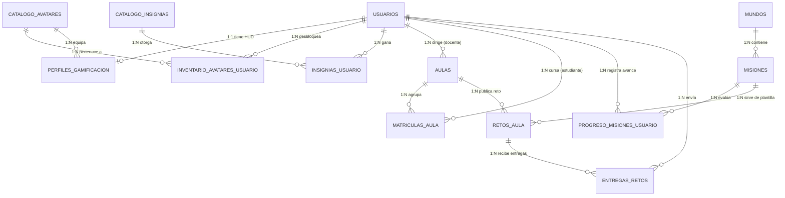

# CODEKIDS — Arquitectura de Base de Datos Relacional y Semilla Funcional (PostgreSQL 16+)

Este documento define la arquitectura de base de datos relacional normalizada hasta la **Tercera Forma Normal (3FN)** para soportar la interfaz gamificada de **CODEKIDS** (HUD de experiencia, niveles, rachas, economía de monedas, tienda de avatares, mapa de misiones con desbloqueo progresivo y calificación de 1 a 3 estrellas, además de aulas docentes).

Todos los **nombres de tablas, columnas, restricciones e índices están íntegramente en español**, utilizando el motor **PostgreSQL 16+** (`citext`, `pgcrypto`).

---

## 1. Documentación del Modelo Entidad-Relación (MER)

### 1.1. Diagrama Entidad-Relación (Mermaid)



---

### 1.2. Esquema Relacional y Cardinalidad (Normalización 3FN)

1. **`usuarios` (1) ─── (0..1) `perfiles_gamificacion`**
   * **Relación Uno a Uno:** Cada usuario tiene un único registro de estado gamificado (`usuario_id` es simultáneamente `PK` y `FK` hacia `usuarios.id`). El nivel no depende transitivamente de otros campos no clave gracias a una columna generada (`GENERATED ALWAYS AS ((puntos_xp / 100) + 1) STORED`), garantizando el cumplimiento estricto de la **3FN**.
2. **`usuarios` (1) ─── (0..N) `inventario_avatares_usuario` (N..0) ─── (1) `catalogo_avatares`**
   * **Relación Muchos a Muchos resuelta:** Un estudiante puede poseer múltiples avatares de la tienda y cada avatar del catálogo puede ser adquirido por muchos estudiantes. La clave primaria compuesta `(usuario_id, avatar_id)` evita duplicados.
3. **`usuarios` (1) ─── (0..N) `aulas` (como Docente) y `aulas` (1) ─── (0..N) `matriculas_aula` (N..0) ─── (1) `usuarios` (como Estudiante)**
   * **Relación Uno a Muchos / Muchos a Muchos:** Un docente crea uno o varios grupos escolares (`5° A`, `6° B`), y los estudiantes se matriculan mediante la tabla asociativa `matriculas_aula`.
4. **`mundos` (1) ─── (1..N) `misiones`**
   * **Relación Uno a Muchos:** Cada mundo del Mapa de Aventura (*Bosque*, *Isla*, *Cueva*, *Estación de Funciones*) agrupa una secuencia ordenada de misiones (`orden_etapa` 1, 2, 3).
5. **`usuarios` (1) ─── (0..N) `progreso_misiones_usuario` (N..0) ─── (1) `misiones`**
   * **Relación Muchos a Muchos con atributos de estado:** Registra el estado individual de cada misión para cada estudiante (`bloqueada`, `disponible`, `completada`), las estrellas obtenidas (`0` a `3`), el número de intentos y la serialización JSON del espacio de trabajo de Blockly.
6. **`usuarios` (1) ─── (0..N) `insignias_usuario` (N..0) ─── (1) `catalogo_insignias`**
   * **Relación Muchos a Muchos resuelta:** Almacena las insignias desbloqueadas por cada estudiante (*Primer código*, *Master bucles*, *Lógica de acero*).

---

### 1.3. Diccionario de Datos Detallado

#### A. Tabla `usuarios` (Identidad y Acceso)
| Columna | Tipo de Dato | Restricciones | Propósito en CODEKIDS |
| :--- | :--- | :--- | :--- |
| `id` | `BIGINT` | `PK`, `IDENTITY (1, 2, 3...)` | Identificador numérico limpio y correlativo del usuario. |
| `correo` | `CITEXT` | `NOT NULL`, `UNIQUE` | Correo electrónico insensible a mayúsculas/minúsculas. |
| `nombre` | `VARCHAR(120)` | `NOT NULL` | Nombre o apodo mostrado en el HUD y selector de aula (ej. *Sofi*). |
| `rol` | `VARCHAR(20)` | `NOT NULL`, `CHECK IN ('estudiante','docente','admin')` | Define si accede al Mapa de Aventura o a la Consola Docente. |
| `contrasena_hash` | `TEXT` | `NULL` | Hash Argon2id de la contraseña (o `NULL` en perfiles rápidos demo/OAuth). |
| `es_perfil_rapido` | `BOOLEAN` | `NOT NULL DEFAULT FALSE` | Indica si el perfil aparece en las tarjetas de acceso rápido de aula. |
| `etiqueta_rapida` | `VARCHAR(60)` | `NULL` | Etiqueta corta para el acceso rápido (ej. `Nvl. 3 · Secuencias`). |
| `intentos_fallidos`| `SMALLINT` | `NOT NULL DEFAULT 0` | Contador de intentos fallidos de inicio de sesión. |
| `bloqueado_hasta` | `TIMESTAMPTZ` | `NULL` | Fecha/hora hasta la que se bloquea temporalmente por seguridad. |
| `activo` | `BOOLEAN` | `NOT NULL DEFAULT TRUE` | Indica si la cuenta se encuentra activa. |
| `ultimo_acceso_en` | `TIMESTAMPTZ` | `NULL` | Fecha y hora del último inicio de sesión. |
| `creado_en` | `TIMESTAMPTZ` | `NOT NULL DEFAULT NOW()` | Fecha de creación de la cuenta. |
| `actualizado_en` | `TIMESTAMPTZ` | `NOT NULL DEFAULT NOW()` | Última fecha de actualización del perfil. |

#### B. Tabla `catalogo_avatares` (Catálogo de Compañeros de la Tienda)
| Columna | Tipo de Dato | Restricciones | Propósito en CODEKIDS |
| :--- | :--- | :--- | :--- |
| `id` | `VARCHAR(32)` | `PK` | Identificador del avatar (`dragon`, `cat`, `robot`, `fox`, `unicorn`, `astronaut`). |
| `nombre_visible` | `VARCHAR(80)` | `NOT NULL` | Nombre visible en la tienda (ej. *Dragón Chispa*, *Unidad Rover*). |
| `costo_monedas` | `INTEGER` | `NOT NULL DEFAULT 0`, `CHECK >= 0` | Precio en monedas virtuales para desbloquearlo. |
| `tono_tema` | `VARCHAR(20)` | `NOT NULL DEFAULT 'blue'` | Tema de color en la UI (`peach`, `lav`, `mint`, `yellow`, `blue`). |
| `descripcion` | `VARCHAR(240)` | `NOT NULL` | Especialidad narrativa del compañero. |
| `es_inicial` | `BOOLEAN` | `NOT NULL DEFAULT FALSE` | Indica si es un avatar disponible desde el inicio. |
| `creado_en` | `TIMESTAMPTZ` | `NOT NULL DEFAULT NOW()` | Fecha de registro en el catálogo. |

#### C. Tabla `perfiles_gamificacion` (HUD Superior de Progreso)
| Columna | Tipo de Dato | Restricciones | Propósito en CODEKIDS |
| :--- | :--- | :--- | :--- |
| `usuario_id` | `BIGINT` | `PK`, `FK -> usuarios(id) ON DELETE CASCADE` | Vincula el perfil gamificado con el usuario. |
| `puntos_xp` | `INTEGER` | `NOT NULL DEFAULT 0`, `CHECK >= 0` | Puntos de experiencia totales acumulados. |
| `nivel_actual` | `INTEGER` | `GENERATED ALWAYS AS ((puntos_xp / 100) + 1) STORED` | Nivel calculado automáticamente cada 100 XP. |
| `saldo_monedas` | `INTEGER` | `NOT NULL DEFAULT 0`, `CHECK >= 0` | Saldo actual de monedas para gastar en la tienda de avatares. |
| `dias_racha` | `INTEGER` | `NOT NULL DEFAULT 1`, `CHECK >= 0` | Días consecutivos resolviendo misiones (Racha activa 🔥). |
| `ultima_fecha_actividad` | `DATE` | `NOT NULL DEFAULT CURRENT_DATE` | Última fecha de misión superada para validar continuidad de racha. |
| `avatar_activo_id` | `VARCHAR(32)` | `NOT NULL`, `FK -> catalogo_avatares(id)` | Avatar equipado actualmente en el HUD y el perfil. |
| `sonido_habilitado`| `BOOLEAN` | `NOT NULL DEFAULT TRUE` | Preferencia de efectos de sonido (Web Audio API). |
| `puntajes_diagnostico` | `JSONB` | `NOT NULL DEFAULT '{}'::jsonb` | Puntajes por habilidad del test diagnóstico (`Secuencias`, `Bucles`, etc.). |
| `actualizado_en` | `TIMESTAMPTZ` | `NOT NULL DEFAULT NOW()` | Fecha de última actualización de estadísticas. |

#### D. Tabla `inventario_avatares_usuario` (Inventario de Avatares Desbloqueados)
| Columna | Tipo de Dato | Restricciones | Propósito en CODEKIDS |
| :--- | :--- | :--- | :--- |
| `usuario_id` | `BIGINT` | `PK (compuesta)`, `FK -> usuarios(id)` | Propietario del avatar. |
| `avatar_id` | `VARCHAR(32)` | `PK (compuesta)`, `FK -> catalogo_avatares(id)` | Avatar desbloqueado o adquirido. |
| `desbloqueado_en` | `TIMESTAMPTZ` | `NOT NULL DEFAULT NOW()` | Fecha y hora de adquisición. |

#### E. Tabla `mundos` (Mundos del Mapa de Aventura)
| Columna | Tipo de Dato | Restricciones | Propósito en CODEKIDS |
| :--- | :--- | :--- | :--- |
| `id` | `VARCHAR(40)` | `PK` | Identificador semántico (`mundo-bosque`, `mundo-isla`, etc.). |
| `orden_mundo` | `SMALLINT` | `NOT NULL`, `UNIQUE` | Orden de aparición en el Mapa de Aventura (`1`, `2`, `3`, `4`). |
| `tematica_habilidad`| `VARCHAR(40)` | `NOT NULL` | Temática para filtros rápidos (`Secuencias`, `Bucles`, `Condicionales`, `Funciones`). |
| `titulo` | `VARCHAR(120)` | `NOT NULL` | Título del mundo (ej. *El Bosque de las Secuencias*). |
| `subtitulo` | `VARCHAR(240)` | `NOT NULL` | Descripción motivacional del mundo. |
| `tono_color` | `VARCHAR(24)` | `NOT NULL` | Clase de color temática (`forest`, `island`, `cave`). |
| `url_imagen_banner`| `VARCHAR(255)` | `NOT NULL` | Ruta de la ilustración 3D (`/images/world-forest.png`). |
| `activo` | `BOOLEAN` | `NOT NULL DEFAULT TRUE` | Indica si el mundo está visible en el mapa. |

#### F. Tabla `misiones` (Ejercicios Interactivos de Blockly / Python)
| Columna | Tipo de Dato | Restricciones | Propósito en CODEKIDS |
| :--- | :--- | :--- | :--- |
| `id` | `VARCHAR(50)` | `PK` | Identificador único de la misión (`sequence-forest`, `loop-bridge`, etc.). |
| `mundo_id` | `VARCHAR(40)` | `NOT NULL`, `FK -> mundos(id)` | Mundo al que pertenece la misión. |
| `orden_etapa` | `SMALLINT` | `NOT NULL`, `CHECK BETWEEN 1 AND 10` | Orden de etapa dentro del mundo (1 = Inicio, 2 = En camino, 3 = Explorador). |
| `nivel_dificultad` | `VARCHAR(30)` | `NOT NULL` | Etiqueta para el filtro de dificultad (`Inicio`, `En camino`, `Explorador`, `Laboratorio`). |
| `plantilla_id` | `VARCHAR(40)` | `NOT NULL` | Plantilla de bloques habilitados (`sequence-order`, `loop-count`, `if-choice`). |
| `nombre_corto` | `VARCHAR(80)` | `NOT NULL` | Nombre corto del escenario (ej. *El bosque*, *El puente*). |
| `titulo_ejercicio` | `VARCHAR(120)` | `NOT NULL` | Título principal de la misión (ej. *El viaje del robot*). |
| `descripcion` | `VARCHAR(240)` | `NOT NULL` | Resumen breve del reto. |
| `instrucciones` | `TEXT` | `NOT NULL` | Instrucción pedagógica explicada por el guía Pipo. |
| `bloque_requerido` | `VARCHAR(40)` | `NULL` | Bloque obligatorio para obtener las 3 estrellas (`ck_repeat`, `ck_if_wall`). |
| `configuracion_tablero` | `JSONB` | `NOT NULL` | Posición inicial, estrella meta y muros: `{"start":{"x":0,"y":2,"direction":0},"goal":{"x":2,"y":0},"wall":null}`. |
| `programa_semilla` | `JSONB` | `NOT NULL DEFAULT '[]'::jsonb` | Bloques iniciales pre-cargados (usado en misiones de depuración). |
| `recompensa_xp` | `INTEGER` | `NOT NULL DEFAULT 10` | Puntos de XP otorgados al completar por primera vez. |
| `recompensa_monedas`| `INTEGER` | `NOT NULL DEFAULT 10` | Monedas otorgadas al completar por primera vez. |

#### G. Tabla `progreso_misiones_usuario` (Estado de Nodos y Estrellas por Estudiante)
| Columna | Tipo de Dato | Restricciones | Propósito en CODEKIDS |
| :--- | :--- | :--- | :--- |
| `usuario_id` | `UUID` | `PK (compuesta)`, `FK -> usuarios(id)` | Estudiante evaluado. |
| `mision_id` | `VARCHAR(50)` | `PK (compuesta)`, `FK -> misiones(id)` | Misión del mapa. |
| `estado` | `VARCHAR(20)` | `NOT NULL`, `CHECK IN ('bloqueada','disponible','completada')` | Controla el renderizado del nodo (🔒 Bloqueada, ⚡ Pulso disponible, 🏆 Completada). |
| `estrellas_ganadas`| `SMALLINT` | `NOT NULL DEFAULT 0`, `CHECK BETWEEN 0 AND 3` | Cantidad de estrellas ganadas (`0` a `3`) según eficiencia de intentos. |
| `cantidad_intentos`| `INTEGER` | `NOT NULL DEFAULT 0`, `CHECK >= 0` | Total de ejecuciones realizadas en la misión. |
| `ultima_evidencia` | `TEXT` | `NULL` | Secuencia textual de bloques ejecutados (`al comenzar -> avanzar -> ...`). |
| `estado_espacio_trabajo` | `JSONB` | `NULL` | Estado serializado de Blockly para restaurar los bloques del alumno. |
| `completada_en` | `TIMESTAMPTZ` | `NULL` | Fecha en que superó la misión por primera vez. |
| `actualizado_en` | `TIMESTAMPTZ` | `NOT NULL DEFAULT NOW()` | Última interacción con el ejercicio. |

#### H. Tablas de Aulas y Retos Escolares (`aulas`, `matriculas_aula`, `retos_aula`, `entregas_retos`)
Gestionan los grupos escolares (`5° A`, `6° B`), la matrícula de estudiantes y las actividades asignadas por el docente con evaluación y retroalimentación asistida por IA (Ollama).

---

## 2. Scripts SQL de Creación (DDL — PostgreSQL 16+)

```sql
-- =============================================================================
-- CODEKIDS — DDL Completo en Español para Gamificación, Mapa de Misiones y Aulas
-- Motor: PostgreSQL 16+
-- =============================================================================

CREATE EXTENSION IF NOT EXISTS citext;
CREATE EXTENSION IF NOT EXISTS pgcrypto;

-- 1. TABLA DE USUARIOS
CREATE TABLE IF NOT EXISTS usuarios (
    id UUID PRIMARY KEY DEFAULT gen_random_uuid(),
    correo CITEXT NOT NULL,
    nombre VARCHAR(120) NOT NULL DEFAULT 'Explorador',
    rol VARCHAR(20) NOT NULL DEFAULT 'estudiante'
        CHECK (rol IN ('estudiante', 'docente', 'admin')),
    correo_verificado_en TIMESTAMPTZ NULL,
    contrasena_hash TEXT NULL,
    es_perfil_rapido BOOLEAN NOT NULL DEFAULT FALSE,
    etiqueta_rapida VARCHAR(60) NULL,
    intentos_fallidos SMALLINT NOT NULL DEFAULT 0 CHECK (intentos_fallidos >= 0),
    bloqueado_hasta TIMESTAMPTZ NULL,
    activo BOOLEAN NOT NULL DEFAULT TRUE,
    ultimo_acceso_en TIMESTAMPTZ NULL,
    creado_en TIMESTAMPTZ NOT NULL DEFAULT NOW(),
    actualizado_en TIMESTAMPTZ NOT NULL DEFAULT NOW(),
    CONSTRAINT uq_usuarios_correo UNIQUE (correo)
);

-- 2. CATÁLOGO DE AVATARES / COMPAÑEROS
CREATE TABLE IF NOT EXISTS catalogo_avatares (
    id VARCHAR(32) PRIMARY KEY,
    nombre_visible VARCHAR(80) NOT NULL,
    costo_monedas INTEGER NOT NULL DEFAULT 0 CHECK (costo_monedas >= 0),
    tono_tema VARCHAR(20) NOT NULL DEFAULT 'blue'
        CHECK (tono_tema IN ('peach', 'lav', 'mint', 'yellow', 'blue')),
    descripcion VARCHAR(240) NOT NULL,
    es_inicial BOOLEAN NOT NULL DEFAULT FALSE,
    creado_en TIMESTAMPTZ NOT NULL DEFAULT NOW()
);

-- 3. PERFIL GAMIFICADO DEL ESTUDIANTE (HUD Superior: XP, Nivel, Racha, Monedas)
CREATE TABLE IF NOT EXISTS perfiles_gamificacion (
    usuario_id UUID PRIMARY KEY REFERENCES usuarios(id) ON DELETE CASCADE,
    puntos_xp INTEGER NOT NULL DEFAULT 0 CHECK (puntos_xp >= 0),
    nivel_actual INTEGER GENERATED ALWAYS AS ((puntos_xp / 100) + 1) STORED,
    saldo_monedas INTEGER NOT NULL DEFAULT 0 CHECK (saldo_monedas >= 0),
    dias_racha INTEGER NOT NULL DEFAULT 1 CHECK (dias_racha >= 0),
    ultima_fecha_actividad DATE NOT NULL DEFAULT CURRENT_DATE,
    avatar_activo_id VARCHAR(32) NOT NULL DEFAULT 'dragon'
        REFERENCES catalogo_avatares(id) ON UPDATE CASCADE,
    sonido_habilitado BOOLEAN NOT NULL DEFAULT TRUE,
    puntajes_diagnostico JSONB NOT NULL DEFAULT '{"Secuencias": 75, "Bucles": 45, "Condicionales": 80, "Descomposición": 55}'::jsonb,
    actualizado_en TIMESTAMPTZ NOT NULL DEFAULT NOW()
);

-- 4. INVENTARIO DE AVATARES DESBLOQUEADOS POR USUARIO (Relación N:M)
CREATE TABLE IF NOT EXISTS inventario_avatares_usuario (
    usuario_id UUID NOT NULL REFERENCES usuarios(id) ON DELETE CASCADE,
    avatar_id VARCHAR(32) NOT NULL REFERENCES catalogo_avatares(id) ON DELETE CASCADE,
    desbloqueado_en TIMESTAMPTZ NOT NULL DEFAULT NOW(),
    PRIMARY KEY (usuario_id, avatar_id)
);

-- 5. CATÁLOGO DE INSIGNIAS Y COLECCIÓN DEL USUARIO
CREATE TABLE IF NOT EXISTS catalogo_insignias (
    id VARCHAR(40) PRIMARY KEY,
    titulo VARCHAR(80) NOT NULL,
    descripcion VARCHAR(200) NOT NULL,
    tematica_habilidad VARCHAR(40) NOT NULL,
    nombre_icono VARCHAR(40) NOT NULL DEFAULT 'Trophy'
);

CREATE TABLE IF NOT EXISTS insignias_usuario (
    usuario_id UUID NOT NULL REFERENCES usuarios(id) ON DELETE CASCADE,
    insignia_id VARCHAR(40) NOT NULL REFERENCES catalogo_insignias(id) ON DELETE CASCADE,
    otorgada_en TIMESTAMPTZ NOT NULL DEFAULT NOW(),
    PRIMARY KEY (usuario_id, insignia_id)
);

-- 6. AULAS / GRUPOS ESCOLARES Y MATRÍCULA
CREATE TABLE IF NOT EXISTS aulas (
    id UUID PRIMARY KEY DEFAULT gen_random_uuid(),
    codigo_grupo VARCHAR(20) NOT NULL UNIQUE, -- Ej. '5° A', '6° B'
    nombre VARCHAR(120) NOT NULL,
    docente_id UUID NOT NULL REFERENCES usuarios(id) ON DELETE RESTRICT,
    anio_escolar SMALLINT NOT NULL DEFAULT 2026,
    creado_en TIMESTAMPTZ NOT NULL DEFAULT NOW()
);

CREATE TABLE IF NOT EXISTS matriculas_aula (
    aula_id UUID NOT NULL REFERENCES aulas(id) ON DELETE CASCADE,
    estudiante_id UUID NOT NULL REFERENCES usuarios(id) ON DELETE CASCADE,
    matriculado_en TIMESTAMPTZ NOT NULL DEFAULT NOW(),
    PRIMARY KEY (aula_id, estudiante_id)
);

-- 7. MUNDOS DEL MAPA DE AVENTURA
CREATE TABLE IF NOT EXISTS mundos (
    id VARCHAR(40) PRIMARY KEY,
    orden_mundo SMALLINT NOT NULL UNIQUE CHECK (orden_mundo > 0),
    tematica_habilidad VARCHAR(40) NOT NULL
        CHECK (tematica_habilidad IN ('Secuencias', 'Bucles', 'Condicionales', 'Funciones', 'Python')),
    titulo VARCHAR(120) NOT NULL,
    subtitulo VARCHAR(240) NOT NULL,
    tono_color VARCHAR(24) NOT NULL DEFAULT 'forest',
    url_imagen_banner VARCHAR(255) NOT NULL,
    activo BOOLEAN NOT NULL DEFAULT TRUE
);

-- 8. MISIONES (EJERCICIOS DE PROGRAMACIÓN POR BLOQUES Y PYTHON)
CREATE TABLE IF NOT EXISTS misiones (
    id VARCHAR(50) PRIMARY KEY,
    mundo_id VARCHAR(40) NOT NULL REFERENCES mundos(id) ON DELETE CASCADE,
    orden_etapa SMALLINT NOT NULL CHECK (orden_etapa BETWEEN 1 AND 10),
    nivel_dificultad VARCHAR(30) NOT NULL
        CHECK (nivel_dificultad IN ('Inicio', 'En camino', 'Explorador', 'Laboratorio')),
    plantilla_id VARCHAR(40) NOT NULL
        CHECK (plantilla_id IN ('sequence-order', 'loop-count', 'if-choice', 'python-script')),
    nombre_corto VARCHAR(80) NOT NULL,
    titulo_ejercicio VARCHAR(120) NOT NULL,
    descripcion VARCHAR(240) NOT NULL,
    instrucciones TEXT NOT NULL,
    bloque_requerido VARCHAR(40) NULL,
    configuracion_tablero JSONB NOT NULL,
    programa_semilla JSONB NOT NULL DEFAULT '[]'::jsonb,
    recompensa_xp INTEGER NOT NULL DEFAULT 10 CHECK (recompensa_xp >= 0),
    recompensa_monedas INTEGER NOT NULL DEFAULT 10 CHECK (recompensa_monedas >= 0),
    CONSTRAINT uq_mundo_orden_etapa UNIQUE (mundo_id, orden_etapa)
);

CREATE INDEX IF NOT EXISTS idx_misiones_mundo_etapa
    ON misiones (mundo_id, orden_etapa);

-- 9. PROGRESO DE MISIONES POR USUARIO (Estado del Mapa y Estrellas)
CREATE TABLE IF NOT EXISTS progreso_misiones_usuario (
    usuario_id UUID NOT NULL REFERENCES usuarios(id) ON DELETE CASCADE,
    mision_id VARCHAR(50) NOT NULL REFERENCES misiones(id) ON DELETE CASCADE,
    estado VARCHAR(20) NOT NULL DEFAULT 'bloqueada'
        CHECK (estado IN ('bloqueada', 'disponible', 'completada')),
    estrellas_ganadas SMALLINT NOT NULL DEFAULT 0
        CHECK (estrellas_ganadas BETWEEN 0 AND 3),
    cantidad_intentos INTEGER NOT NULL DEFAULT 0
        CHECK (cantidad_intentos >= 0),
    ultima_evidencia TEXT NULL,
    estado_espacio_trabajo JSONB NULL,
    completada_en TIMESTAMPTZ NULL,
    actualizado_en TIMESTAMPTZ NOT NULL DEFAULT NOW(),
    PRIMARY KEY (usuario_id, mision_id)
);

CREATE INDEX IF NOT EXISTS idx_progreso_usuario_estado
    ON progreso_misiones_usuario (usuario_id, estado);

-- 10. RETOS ESCOLARES ASIGNADOS POR EL DOCENTE Y ENTREGAS
CREATE TABLE IF NOT EXISTS retos_aula (
    id UUID PRIMARY KEY DEFAULT gen_random_uuid(),
    aula_id UUID NOT NULL REFERENCES aulas(id) ON DELETE CASCADE,
    mision_id VARCHAR(50) NOT NULL REFERENCES misiones(id) ON DELETE RESTRICT,
    titulo VARCHAR(140) NOT NULL,
    instrucciones TEXT NOT NULL,
    tematica_habilidad VARCHAR(40) NOT NULL,
    creado_en TIMESTAMPTZ NOT NULL DEFAULT NOW()
);

CREATE TABLE IF NOT EXISTS entregas_retos (
    id UUID PRIMARY KEY DEFAULT gen_random_uuid(),
    reto_id UUID NOT NULL REFERENCES retos_aula(id) ON DELETE CASCADE,
    estudiante_id UUID NOT NULL REFERENCES usuarios(id) ON DELETE CASCADE,
    puntaje SMALLINT NOT NULL CHECK (puntaje BETWEEN 0 AND 100),
    cantidad_intentos INTEGER NOT NULL DEFAULT 1 CHECK (cantidad_intentos > 0),
    logrado BOOLEAN NOT NULL DEFAULT FALSE,
    texto_evidencia TEXT NOT NULL,
    retroalimentacion_ia TEXT NOT NULL,
    recomendacion_docente TEXT NOT NULL,
    fuente_evaluacion VARCHAR(30) NOT NULL DEFAULT 'ollama',
    entregado_en TIMESTAMPTZ NOT NULL DEFAULT NOW(),
    CONSTRAINT uq_reto_estudiante UNIQUE (reto_id, estudiante_id)
);
```

---

## 3. Scripts SQL de Semilla (DML — Seed Data Realista en Español)

Este script puebla la base de datos con los avatares, insignias, los 4 usuarios rápidos de aula (**Sofi**, **Mateo**, **Valeria** y **Profe Alex**), los 4 mundos, las 12 misiones de programación por bloques y el estado exacto de progreso (`completada` con estrellas, `disponible` con brillo pulsante y `bloqueada`).

```sql
-- =============================================================================
-- CODEKIDS — DML Seed Data en Español (Datos Iniciales Coherentes con la UI)
-- =============================================================================

BEGIN;

-- 1. SEMILLA DE AVATARES (Tienda de Compañeros)
INSERT INTO catalogo_avatares (id, nombre_visible, costo_monedas, tono_tema, descripcion, es_inicial) VALUES
    ('astronaut', 'Explorador Estelar', 0,  'blue',   'Traje espacial estándar para nuevas misiones.', TRUE),
    ('dragon',    'Dragón Chispa',      30, 'peach',  'Especialista en lógica y secuencias rápidas.', TRUE),
    ('cat',       'Gato Pixel',         30, 'lav',    'Observador preciso para depurar programas.', FALSE),
    ('robot',     'Unidad Rover',       40, 'mint',   'Diseñado para exploración autónoma por bloques.', TRUE),
    ('fox',       'Zorro Ágil',         50, 'yellow', 'Estratega en bucles y rutas óptimas.', TRUE),
    ('unicorn',   'Prisma Orbital',     60, 'blue',   'Compañero avanzado de laboratorio Python.', TRUE)
ON CONFLICT (id) DO UPDATE SET
    nombre_visible = EXCLUDED.nombre_visible,
    costo_monedas = EXCLUDED.costo_monedas,
    tono_tema = EXCLUDED.tono_tema,
    descripcion = EXCLUDED.descripcion;

-- 2. SEMILLA DE INSIGNIAS (Colección de Medallas)
INSERT INTO catalogo_insignias (id, titulo, descripcion, tematica_habilidad, nombre_icono) VALUES
    ('insignia-primer-codigo', 'Primer código',   'Completaste tu primera misión de programación por bloques.', 'Secuencias',    'Compass'),
    ('insignia-master-bucles', 'Master bucles',   'Dominaste las tres etapas de La Isla de los Bucles.',        'Bucles',        'SlidersHorizontal'),
    ('insignia-logica-acero',  'Lógica de acero', 'Superaste todos los retos de La Cueva de las Decisiones.',   'Condicionales', 'Brain')
ON CONFLICT (id) DO NOTHING;

-- 3. SEMILLA DE USUARIOS (Perfiles Rápidos de Aula: Sofi, Mateo, Valeria y Profe Alex)
INSERT INTO usuarios (id, correo, nombre, rol, correo_verificado_en, es_perfil_rapido, etiqueta_rapida) VALUES
    ('11111111-1111-4111-8111-111111111101', 'sofi@codekids.edu.co',       'Sofi',       'estudiante', NOW(), TRUE, 'Nvl. 3 · Secuencias'),
    ('11111111-1111-4111-8111-111111111102', 'mateo@codekids.edu.co',      'Mateo',      'estudiante', NOW(), TRUE, 'Nvl. 2 · Bucles'),
    ('11111111-1111-4111-8111-111111111103', 'valeria@codekids.edu.co',    'Valeria',    'estudiante', NOW(), TRUE, 'Nvl. 4 · Python'),
    ('11111111-1111-4111-8111-111111111104', 'alex.profe@codekids.edu.co', 'Profe Alex', 'docente',    NOW(), TRUE, 'Docente · 5° A')
ON CONFLICT (correo) DO UPDATE SET
    nombre = EXCLUDED.nombre,
    es_perfil_rapido = EXCLUDED.es_perfil_rapido,
    etiqueta_rapida = EXCLUDED.etiqueta_rapida;

-- 4. SEMILLA DE PERFILES GAMIFICADOS (XP, Nivel auto-calculado, Monedas, Racha y Avatar activo)
-- Nota: nivel_actual se calcula automáticamente: Sofi (240 XP -> Nvl 3), Mateo (130 XP -> Nvl 2), Valeria (360 XP -> Nvl 4)
INSERT INTO perfiles_gamificacion
    (usuario_id, puntos_xp, saldo_monedas, dias_racha, ultima_fecha_actividad, avatar_activo_id, sonido_habilitado, puntajes_diagnostico)
VALUES
    (
        '11111111-1111-4111-8111-111111111101', -- Sofi
        240, 65, 5, CURRENT_DATE, 'dragon', TRUE,
        '{"Secuencias": 92, "Bucles": 68, "Condicionales": 75, "Descomposición": 70}'::jsonb
    ),
    (
        '11111111-1111-4111-8111-111111111102', -- Mateo
        130, 40, 3, CURRENT_DATE, 'robot', TRUE,
        '{"Secuencias": 80, "Bucles": 62, "Condicionales": 58, "Descomposición": 55}'::jsonb
    ),
    (
        '11111111-1111-4111-8111-111111111103', -- Valeria
        360, 110, 9, CURRENT_DATE, 'fox', TRUE,
        '{"Secuencias": 98, "Bucles": 95, "Condicionales": 88, "Descomposición": 90}'::jsonb
    )
ON CONFLICT (usuario_id) DO UPDATE SET
    puntos_xp = EXCLUDED.puntos_xp,
    saldo_monedas = EXCLUDED.saldo_monedas,
    dias_racha = EXCLUDED.dias_racha,
    avatar_activo_id = EXCLUDED.avatar_activo_id;

-- 5. INVENTARIO DE AVATARES DESBLOQUEADOS
INSERT INTO inventario_avatares_usuario (usuario_id, avatar_id) VALUES
    ('11111111-1111-4111-8111-111111111101', 'astronaut'),
    ('11111111-1111-4111-8111-111111111101', 'dragon'),
    ('11111111-1111-4111-8111-111111111101', 'cat'),
    ('11111111-1111-4111-8111-111111111102', 'astronaut'),
    ('11111111-1111-4111-8111-111111111102', 'robot'),
    ('11111111-1111-4111-8111-111111111103', 'astronaut'),
    ('11111111-1111-4111-8111-111111111103', 'fox'),
    ('11111111-1111-4111-8111-111111111103', 'unicorn')
ON CONFLICT DO NOTHING;

-- 6. AULAS ESCOLARES Y MATRÍCULA DE ESTUDIANTES
INSERT INTO aulas (id, codigo_grupo, nombre, docente_id, anio_escolar) VALUES
    ('22222222-2222-4222-8222-222222222201', '5° A', 'Exploradores de Pensamiento Computacional 5° A', '11111111-1111-4111-8111-111111111104', 2026),
    ('22222222-2222-4222-8222-222222222202', '6° B', 'Laboratorio de Algoritmos y Python 6° B',        '11111111-1111-4111-8111-111111111104', 2026)
ON CONFLICT (codigo_grupo) DO NOTHING;

INSERT INTO matriculas_aula (aula_id, estudiante_id) VALUES
    ('22222222-2222-4222-8222-222222222201', '11111111-1111-4111-8111-111111111101'), -- Sofi en 5° A
    ('22222222-2222-4222-8222-222222222201', '11111111-1111-4111-8111-111111111102'), -- Mateo en 5° A
    ('22222222-2222-4222-8222-222222222201', '11111111-1111-4111-8111-111111111103')  -- Valeria en 5° A
ON CONFLICT DO NOTHING;

-- 7. MUNDOS DEL MAPA DE AVENTURA
INSERT INTO mundos (id, orden_mundo, tematica_habilidad, titulo, subtitulo, tono_color, url_imagen_banner) VALUES
    ('mundo-bosque',    1, 'Secuencias',    'El Bosque de las Secuencias',          'Guía a los robots por nuevos caminos paso a paso',          'forest', '/images/world-forest.png'),
    ('mundo-isla',      2, 'Bucles',        'La Isla de los Bucles',                'Descubre patrones que se repiten para ahorrar energía',     'island', '/images/world-island.png'),
    ('mundo-cueva',     3, 'Condicionales', 'La Cueva de las Decisiones',           'Elige qué hacer ante cada obstáculo con sensores',          'cave',   '/images/world-cave.png'),
    ('mundo-funciones', 4, 'Funciones',     'Estación de Funciones y Depuración',   'Repara módulos de código y domina rutinas avanzadas',       'forest', '/images/python-lab.png')
ON CONFLICT (id) DO UPDATE SET
    titulo = EXCLUDED.titulo,
    subtitulo = EXCLUDED.subtitulo;

-- 8. MISIONES (12 Ejercicios Oficiales de Blockly)
INSERT INTO misiones
    (id, mundo_id, orden_etapa, nivel_dificultad, plantilla_id, nombre_corto, titulo_ejercicio, descripcion, instrucciones, bloque_requerido, configuracion_tablero, programa_semilla, recompensa_xp, recompensa_monedas)
VALUES
    -- MUNDO 1: Secuencias
    ('sequence-forest', 'mundo-bosque', 1, 'Inicio',     'sequence-order', 'El bosque', 'El viaje del robot',  'Ordena pasos y giros para llegar a la meta.', 'Arma una secuencia de bloques para llevar al robot hasta la meta.', NULL,
     '{"start":{"x":0,"y":2,"direction":0},"goal":{"x":2,"y":0},"wall":null}'::jsonb, '[]'::jsonb, 10, 10),
    ('sequence-city',   'mundo-bosque', 2, 'En camino',  'sequence-order', 'La ciudad', 'Cruza la ciudad',     'Planea una ruta alrededor de la estructura central.', 'Guía al robot por la ciudad y rodea el obstáculo central para alcanzar la meta.', NULL,
     '{"start":{"x":0,"y":1,"direction":0},"goal":{"x":2,"y":1},"wall":{"x":1,"y":1}}'::jsonb, '[]'::jsonb, 10, 10),
    ('sequence-moon',   'mundo-bosque', 3, 'Explorador', 'sequence-order', 'La luna',   'Ruta lunar',          'Traza una ruta evitando el cráter central.', 'Programa el camino hasta la meta sin cruzar el cráter.', NULL,
     '{"start":{"x":0,"y":2,"direction":1},"goal":{"x":2,"y":0},"wall":{"x":1,"y":1}}'::jsonb, '[]'::jsonb, 15, 15),

    -- MUNDO 2: Bucles
    ('loop-bridge',     'mundo-isla',   1, 'Inicio',     'loop-count',     'El puente', 'Cruza el puente',     'Repite avanzar para cruzar con precisión.', 'Usa el bloque «repetir» para que el robot cruce el puente.', 'ck_repeat',
     '{"start":{"x":0,"y":2,"direction":1},"goal":{"x":2,"y":2},"wall":null}'::jsonb, '[]'::jsonb, 10, 10),
    ('loop-zigzag',     'mundo-isla',   2, 'En camino',  'loop-count',     'El zigzag', 'Trayectoria en zigzag','Repite un patrón de avance y giro.', 'Crea un patrón con «repetir»: avanzar y girar a la izquierda.', 'ck_repeat',
     '{"start":{"x":0,"y":2,"direction":1},"goal":{"x":1,"y":1},"wall":null}'::jsonb, '[]'::jsonb, 15, 10),
    ('loop-garden',     'mundo-isla',   3, 'Explorador', 'loop-count',     'El jardín', 'Recorrido botánico',  'Combina repetir y girar para recorrer el jardín.', 'Usa «repetir» para avanzar por el sendero y luego gira hacia la meta.', 'ck_repeat',
     '{"start":{"x":0,"y":2,"direction":1},"goal":{"x":2,"y":1},"wall":null}'::jsonb, '[]'::jsonb, 20, 15),

    -- MUNDO 3: Condicionales
    ('condition-detour','mundo-cueva',  1, 'Inicio',     'if-choice',      'El desvío', 'Rodea el muro',       'Decide qué hacer cuando aparece un obstáculo.', 'Usa «si hay pared» para elegir un camino libre hasta la meta.', 'ck_if_wall',
     '{"start":{"x":0,"y":0,"direction":1},"goal":{"x":2,"y":0},"wall":{"x":1,"y":0}}'::jsonb, '[]'::jsonb, 15, 10),
    ('condition-cave',  'mundo-cueva',  2, 'En camino',  'if-choice',      'La galería','Busca otra salida',   'Detecta el muro y encuentra la salida lateral.', 'Si el robot detecta una pared, hazlo girar y guíalo hasta la meta.', 'ck_if_wall',
     '{"start":{"x":2,"y":2,"direction":0},"goal":{"x":0,"y":0},"wall":{"x":2,"y":1}}'::jsonb, '[]'::jsonb, 15, 15),
    ('condition-river', 'mundo-cueva',  3, 'Explorador', 'if-choice',      'El canal',  'Encuentra el paso',   'Comprueba la condición y rodea el canal.', 'Al encontrar el borde del canal, gira y cruza hasta la meta.', 'ck_if_wall',
     '{"start":{"x":0,"y":0,"direction":2},"goal":{"x":2,"y":2},"wall":{"x":0,"y":1}}'::jsonb, '[]'::jsonb, 20, 20),

    -- MUNDO 4: Funciones y Depuración
    ('debug-sequence',  'mundo-funciones', 1, 'Inicio',     'sequence-order', 'El giro equivocado',       'Encuentra el error',   'Revisa un programa que se desvía del camino.', 'El robot tiene un programa con un error. Prueba, encuentra el giro equivocado y corrígelo.', NULL,
     '{"start":{"x":0,"y":2,"direction":0},"goal":{"x":2,"y":0},"wall":null}'::jsonb,
     '[{"type":"ck_move"},{"type":"ck_turn_left"},{"type":"ck_move"}]'::jsonb, 15, 15),
    ('debug-loop',      'mundo-funciones', 2, 'En camino',  'loop-count',     'La repetición incompleta', 'Ajusta el bucle',      'Ajusta un bucle que se detiene antes de la meta.', 'El robot se queda corto. Revisa cuántas veces se repite el paso y corrige el programa.', 'ck_repeat',
     '{"start":{"x":0,"y":2,"direction":1},"goal":{"x":2,"y":2},"wall":null}'::jsonb,
     '[{"type":"ck_repeat","times":1,"body":[{"type":"ck_move"}]}]'::jsonb, 20, 15),
    ('debug-condition', 'mundo-funciones', 3, 'Explorador', 'if-choice',      'La decisión invertida',    'Corrige la decisión',  'Repara una condición que orienta al robot hacia el obstáculo.', 'Prueba el programa y cambia la acción del bloque «si hay pared» para tomar el desvío.', 'ck_if_wall',
     '{"start":{"x":0,"y":0,"direction":1},"goal":{"x":2,"y":0},"wall":{"x":1,"y":0}}'::jsonb,
     '[{"type":"ck_if_wall","body":[{"type":"ck_turn_left"}]},{"type":"ck_move"},{"type":"ck_move"}]'::jsonb, 25, 20)
ON CONFLICT (id) DO NOTHING;

-- 9. PROGRESO DE MISIONES PARA SOFI (Mundo 1 completo con estrellas, Mundo 2 en progreso, Mundo 3 bloqueado)
INSERT INTO progreso_misiones_usuario (usuario_id, mision_id, estado, estrellas_ganadas, cantidad_intentos, ultima_evidencia, completada_en) VALUES
    -- Mundo 1: Completado (Desbloquea Mundo 2)
    ('11111111-1111-4111-8111-111111111101', 'sequence-forest',  'completada', 3, 1, 'Programa: al comenzar -> avanzar -> avanzar -> girar derecha -> avanzar -> avanzar', NOW() - INTERVAL '4 days'),
    ('11111111-1111-4111-8111-111111111101', 'sequence-city',    'completada', 2, 2, 'Programa: al comenzar -> avanzar -> girar derecha -> avanzar -> avanzar', NOW() - INTERVAL '3 days'),
    ('11111111-1111-4111-8111-111111111101', 'sequence-moon',    'completada', 3, 1, 'Programa: al comenzar -> avanzar -> avanzar -> girar izquierda -> avanzar -> avanzar', NOW() - INTERVAL '2 days'),
    -- Mundo 2: Etapa 1 completada, Etapa 2 disponible (Brillo pulsante), Etapa 3 bloqueada
    ('11111111-1111-4111-8111-111111111101', 'loop-bridge',      'completada', 3, 1, 'Programa: al comenzar -> repetir 2 veces (avanzar)', NOW() - INTERVAL '1 day'),
    ('11111111-1111-4111-8111-111111111101', 'loop-zigzag',      'disponible', 0, 1, NULL, NULL),
    ('11111111-1111-4111-8111-111111111101', 'loop-garden',      'bloqueada',  0, 0, NULL, NULL),
    -- Mundo 3: Bloqueado
    ('11111111-1111-4111-8111-111111111101', 'condition-detour', 'bloqueada',  0, 0, NULL, NULL),
    ('11111111-1111-4111-8111-111111111101', 'condition-cave',   'bloqueada',  0, 0, NULL, NULL),
    ('11111111-1111-4111-8111-111111111101', 'condition-river',  'bloqueada',  0, 0, NULL, NULL),
    -- Mundo 4: Laboratorio de Depuración (Etapa 1 disponible)
    ('11111111-1111-4111-8111-111111111101', 'debug-sequence',   'disponible', 0, 0, NULL, NULL),
    ('11111111-1111-4111-8111-111111111101', 'debug-loop',       'bloqueada',  0, 0, NULL, NULL),
    ('11111111-1111-4111-8111-111111111101', 'debug-condition',  'bloqueada',  0, 0, NULL, NULL)
ON CONFLICT (usuario_id, mision_id) DO UPDATE SET
    estado = EXCLUDED.estado,
    estrellas_ganadas = EXCLUDED.estrellas_ganadas;

-- 10. PROGRESO DE MISIONES PARA MATEO Y VALERIA
INSERT INTO progreso_misiones_usuario (usuario_id, mision_id, estado, estrellas_ganadas, cantidad_intentos, completada_en) VALUES
    -- Mateo: Etapa 1 completada, Etapa 2 disponible
    ('11111111-1111-4111-8111-111111111102', 'sequence-forest',  'completada', 2, 3, NOW() - INTERVAL '1 day'),
    ('11111111-1111-4111-8111-111111111102', 'sequence-city',    'disponible', 0, 0, NULL),
    ('11111111-1111-4111-8111-111111111102', 'sequence-moon',    'bloqueada',  0, 0, NULL),
    -- Valeria: Mundos 1 y 2 completos con 3 estrellas, Mundo 3 disponible
    ('11111111-1111-4111-8111-111111111103', 'sequence-forest',  'completada', 3, 1, NOW() - INTERVAL '7 days'),
    ('11111111-1111-4111-8111-111111111103', 'sequence-city',    'completada', 3, 1, NOW() - INTERVAL '6 days'),
    ('11111111-1111-4111-8111-111111111103', 'sequence-moon',    'completada', 3, 1, NOW() - INTERVAL '5 days'),
    ('11111111-1111-4111-8111-111111111103', 'loop-bridge',      'completada', 3, 1, NOW() - INTERVAL '4 days'),
    ('11111111-1111-4111-8111-111111111103', 'loop-zigzag',      'completada', 3, 1, NOW() - INTERVAL '3 days'),
    ('11111111-1111-4111-8111-111111111103', 'loop-garden',      'completada', 3, 2, NOW() - INTERVAL '2 days'),
    ('11111111-1111-4111-8111-111111111103', 'condition-detour', 'disponible', 0, 0, NULL)
ON CONFLICT (usuario_id, mision_id) DO NOTHING;

-- 11. INSIGNIAS OTORGADAS
INSERT INTO insignias_usuario (usuario_id, insignia_id) VALUES
    ('11111111-1111-4111-8111-111111111101', 'insignia-primer-codigo'),
    ('11111111-1111-4111-8111-111111111102', 'insignia-primer-codigo'),
    ('11111111-1111-4111-8111-111111111103', 'insignia-primer-codigo'),
    ('11111111-1111-4111-8111-111111111103', 'insignia-master-bucles')
ON CONFLICT DO NOTHING;

COMMIT;
```

---

## 4. Consultas Clave de Integración (SQL Queries en Español)

### 4.1. Obtener el Perfil Gamificado del Usuario (HUD Superior + Inventario de Avatares + Insignias)
Alimenta la barra superior flotante (`Header`), el progreso de experiencia (`xp_en_nivel_actual / 100`) y el modal de la tienda de compañeros (`AvatarShop`).

```sql
-- Parámetro: $1 = usuario_id (UUID)
SELECT
    u.id AS usuario_id,
    u.nombre,
    u.correo,
    u.rol,
    pg.puntos_xp,
    pg.nivel_actual,
    (pg.puntos_xp % 100) AS xp_en_nivel_actual,
    (100 - (pg.puntos_xp % 100)) AS xp_para_siguiente_nivel,
    pg.saldo_monedas,
    pg.dias_racha,
    pg.avatar_activo_id,
    ca.nombre_visible AS nombre_avatar_activo,
    ca.tono_tema AS tono_avatar_activo,
    pg.sonido_habilitado,
    pg.puntajes_diagnostico,
    COALESCE(
        (SELECT json_agg(iau.avatar_id ORDER BY iau.desbloqueado_en)
         FROM inventario_avatares_usuario iau
         WHERE iau.usuario_id = u.id),
        '["astronaut"]'::json
    ) AS avatares_desbloqueados,
    COALESCE(
        (SELECT json_agg(iu.insignia_id ORDER BY iu.otorgada_en)
         FROM insignias_usuario iu
         WHERE iu.usuario_id = u.id),
        '[]'::json
    ) AS insignias_ganadas
FROM usuarios u
LEFT JOIN perfiles_gamificacion pg ON pg.usuario_id = u.id
LEFT JOIN catalogo_avatares ca ON ca.id = pg.avatar_activo_id
WHERE u.id = $1;
```

---

### 4.2. Obtener el Mapa de Aventura Completo y Estado de Misiones para un Usuario
Alimenta el componente `StudentDashboard`, devolviendo todos los mundos en orden, el conteo de estrellas ganadas por mundo y cada misión con su estado (`bloqueada`, `disponible`, `completada`) y calificación de estrellas (`0..3`).

```sql
-- Parámetros: $1 = usuario_id (UUID), $2 = tematica_habilidad opcional (NULL o 'Todos' para traer todos)
SELECT
    mu.id AS mundo_id,
    mu.orden_mundo,
    mu.tematica_habilidad,
    mu.titulo AS titulo_mundo,
    mu.subtitulo AS subtitulo_mundo,
    mu.tono_color,
    mu.url_imagen_banner,
    COUNT(mi.id) FILTER (WHERE pmu.estado = 'completada') AS etapas_completadas,
    COALESCE(SUM(pmu.estrellas_ganadas), 0) AS estrellas_ganadas_mundo,
    COUNT(mi.id) * 3 AS estrellas_maximas_mundo,
    json_agg(
        json_build_object(
            'misionId', mi.id,
            'ordenEtapa', mi.orden_etapa,
            'nivelDificultad', mi.nivel_dificultad,
            'nombreCorto', mi.nombre_corto,
            'tituloEjercicio', mi.titulo_ejercicio,
            'estado', COALESCE(pmu.estado, CASE WHEN mu.orden_mundo = 1 AND mi.orden_etapa = 1 THEN 'disponible' ELSE 'bloqueada' END),
            'estrellasGanadas', COALESCE(pmu.estrellas_ganadas, 0),
            'cantidadIntentos', COALESCE(pmu.cantidad_intentos, 0),
            'recompensaXp', mi.recompensa_xp,
            'recompensaMonedas', mi.recompensa_monedas
        ) ORDER BY mi.orden_etapa ASC
    ) AS misiones
FROM mundos mu
JOIN misiones mi ON mi.mundo_id = mu.id
LEFT JOIN progreso_misiones_usuario pmu
    ON pmu.mision_id = mi.id AND pmu.usuario_id = $1
WHERE mu.activo = TRUE
  AND ($2::varchar IS NULL OR $2 = 'Todos' OR mu.tematica_habilidad = $2)
GROUP BY mu.id, mu.orden_mundo, mu.tematica_habilidad, mu.titulo, mu.subtitulo, mu.tono_color, mu.url_imagen_banner
ORDER BY mu.orden_mundo ASC;
```

---

### 4.3. Transacción Atómica: Registrar Finalización de Ejercicio, Calcular Estrellas, Otorgar XP/Monedas y Desbloquear Siguiente Misión
Cuando el estudiante completa un reto en `BlocklyMission`, esta consulta CTE ejecuta en una sola transacción:
1. Calcula las estrellas ganadas (`3 estrellas` si lo logra en 1-2 intentos, `2 estrellas` en 3-4 intentos, `1 estrella` en 5+ intentos).
2. Verifica si es la primera vez que completa la misión (`es_primera_vez`) para otorgar XP y monedas sin permitir *farming* infinito.
3. Actualiza la racha diaria (`dias_racha`) si la última actividad fue ayer.
4. Desbloquea automáticamente la siguiente misión del mapa (`estado = 'disponible'`).

```sql
-- Parámetros:
-- $1 = usuario_id (UUID)
-- $2 = mision_id (VARCHAR, ej. 'loop-zigzag')
-- $3 = intentos_sesion (INTEGER, ej. 1)
-- $4 = texto_evidencia (TEXT)
-- $5 = espacio_trabajo_json (JSONB)

WITH info_mision AS (
    SELECT id, mundo_id, orden_etapa, recompensa_xp, recompensa_monedas
    FROM misiones
    WHERE id = $2
),
progreso_previo AS (
    SELECT estado, estrellas_ganadas
    FROM progreso_misiones_usuario
    WHERE usuario_id = $1 AND mision_id = $2
),
calculo_estrellas AS (
    SELECT
        CASE
            WHEN $3 <= 2 THEN 3
            WHEN $3 <= 4 THEN 2
            ELSE 1
        END AS nuevas_estrellas,
        COALESCE((SELECT estado FROM progreso_previo) <> 'completada', TRUE) AS es_primera_vez
),
guardar_mision_actual AS (
    INSERT INTO progreso_misiones_usuario (
        usuario_id, mision_id, estado, estrellas_ganadas, cantidad_intentos, ultima_evidencia, estado_espacio_trabajo, completada_en, actualizado_en
    )
    SELECT
        $1, $2, 'completada', ce.nuevas_estrellas, $3, $4, $5, NOW(), NOW()
    FROM calculo_estrellas ce
    ON CONFLICT (usuario_id, mision_id) DO UPDATE SET
        estado = 'completada',
        estrellas_ganadas = GREATEST(progreso_misiones_usuario.estrellas_ganadas, EXCLUDED.estrellas_ganadas),
        cantidad_intentos = progreso_misiones_usuario.cantidad_intentos + $3,
        ultima_evidencia = EXCLUDED.ultima_evidencia,
        estado_espacio_trabajo = EXCLUDED.estado_espacio_trabajo,
        completada_en = COALESCE(progreso_misiones_usuario.completada_en, NOW()),
        actualizado_en = NOW()
    RETURNING estado, estrellas_ganadas
),
candidata_siguiente_mision AS (
    -- Busca la siguiente etapa en el mismo mundo o la etapa 1 del siguiente mundo
    SELECT m_sig.id AS siguiente_mision_id
    FROM info_mision im
    JOIN mundos mu_actual ON mu_actual.id = im.mundo_id
    LEFT JOIN mundos mu_sig ON mu_sig.orden_mundo = mu_actual.orden_mundo + 1
    JOIN misiones m_sig ON (
        (m_sig.mundo_id = im.mundo_id AND m_sig.orden_etapa = im.orden_etapa + 1)
        OR (im.orden_etapa = 3 AND m_sig.mundo_id = mu_sig.id AND m_sig.orden_etapa = 1)
    )
    ORDER BY m_sig.orden_etapa ASC
    LIMIT 1
),
desbloquear_siguiente_mision AS (
    INSERT INTO progreso_misiones_usuario (usuario_id, mision_id, estado, estrellas_ganadas, cantidad_intentos)
    SELECT $1, csm.siguiente_mision_id, 'disponible', 0, 0
    FROM candidata_siguiente_mision csm
    ON CONFLICT (usuario_id, mision_id) DO UPDATE SET
        estado = CASE
            WHEN progreso_misiones_usuario.estado = 'bloqueada' THEN 'disponible'
            ELSE progreso_misiones_usuario.estado
        END,
        actualizado_en = NOW()
    RETURNING mision_id AS mision_desbloqueada_id
)
UPDATE perfiles_gamificacion pg
SET
    puntos_xp = pg.puntos_xp + CASE WHEN ce.es_primera_vez THEN im.recompensa_xp ELSE 0 END,
    saldo_monedas = pg.saldo_monedas + CASE WHEN ce.es_primera_vez THEN im.recompensa_monedas ELSE 0 END,
    dias_racha = CASE
        WHEN pg.ultima_fecha_actividad = CURRENT_DATE THEN pg.dias_racha
        WHEN pg.ultima_fecha_actividad = CURRENT_DATE - INTERVAL '1 day' THEN pg.dias_racha + 1
        ELSE 1
    END,
    ultima_fecha_actividad = CURRENT_DATE,
    actualizado_en = NOW()
FROM info_mision im, calculo_estrellas ce
WHERE pg.usuario_id = $1
RETURNING
    pg.puntos_xp,
    pg.nivel_actual,
    pg.saldo_monedas,
    pg.dias_racha,
    ce.es_primera_vez,
    (SELECT estrellas_ganadas FROM guardar_mision_actual) AS estrellas_ganadas,
    (SELECT mision_desbloqueada_id FROM desbloquear_siguiente_mision) AS mision_desbloqueada_id;
```

---

### 4.4. Comprar y Equipar un Avatar en la Tienda (`AvatarShop`)
Verifica que el estudiante tenga saldo suficiente de monedas, descuenta el costo, añade el avatar al inventario y lo equipa en una sola operación segura.

```sql
-- Parámetros: $1 = usuario_id (UUID), $2 = avatar_id (VARCHAR, ej. 'fox')
WITH avatar_objetivo AS (
    SELECT id, costo_monedas
    FROM catalogo_avatares
    WHERE id = $2
),
descontar_monedas AS (
    UPDATE perfiles_gamificacion pg
    SET
        saldo_monedas = pg.saldo_monedas - ao.costo_monedas,
        avatar_activo_id = ao.id,
        actualizado_en = NOW()
    FROM avatar_objetivo ao
    WHERE pg.usuario_id = $1
      AND pg.saldo_monedas >= ao.costo_monedas
      AND NOT EXISTS (
          SELECT 1 FROM inventario_avatares_usuario iau
          WHERE iau.usuario_id = $1 AND iau.avatar_id = ao.id
      )
    RETURNING pg.usuario_id, pg.saldo_monedas, pg.avatar_activo_id
)
INSERT INTO inventario_avatares_usuario (usuario_id, avatar_id)
SELECT dm.usuario_id, dm.avatar_activo_id
FROM descontar_monedas dm
RETURNING usuario_id, avatar_id, desbloqueado_en;
```
